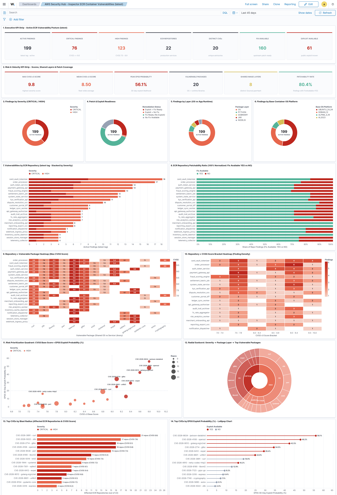
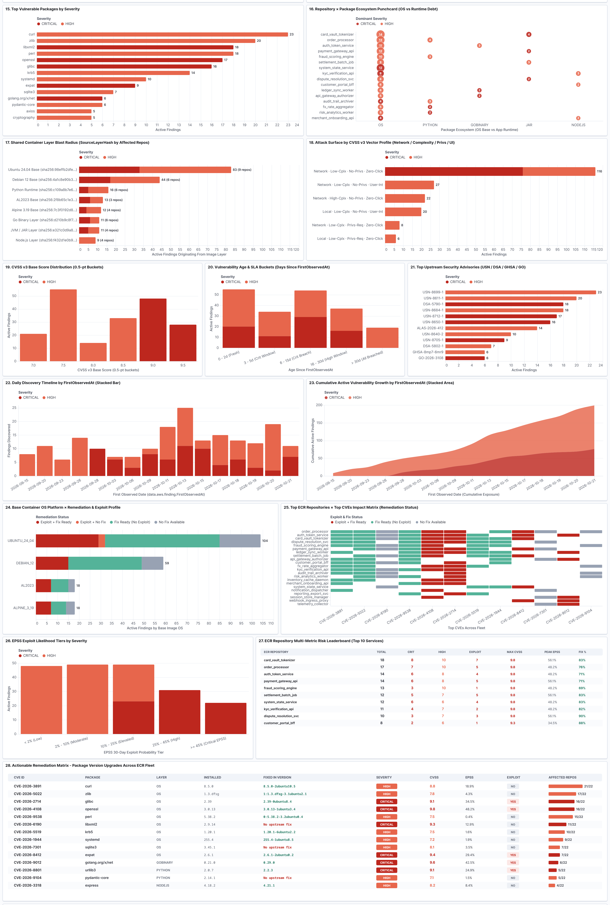
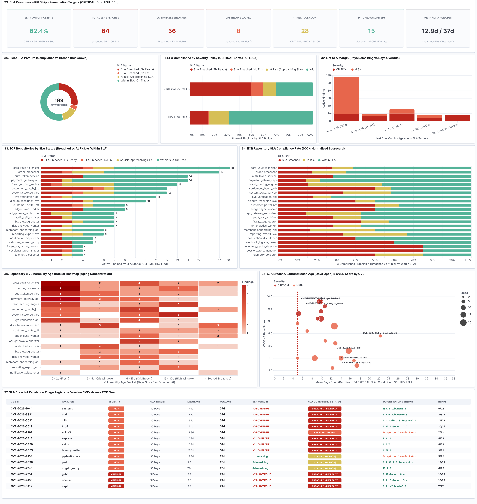

# AWS Security Hub - Amazon Inspector ECR Container Vulnerability Integration

This folder contains a Wazuh custom ruleset, sample AWS Security Finding Format (ASFF) event, and a 37-panel Vega / Vega-Lite dashboard (`aws-ecr-inspector-vega-dashboard`) for monitoring, prioritizing, and tracking SLA compliance of `CRITICAL` and `HIGH` container image vulnerabilities discovered by **Amazon Inspector** on **Amazon ECR** (`:latest` images) and ingested into Wazuh via **AWS Security Hub**.

---

## Dashboard Previews

### Part 1 - Executive Posture, ECR Repository Risk & CVSS/EPSS Prioritization (Panels 1-16)


### Part 2 - Shared Container Layers, Timelines, Advisories & Actionable Package Upgrades (Panels 17-28)


### Part 3 - SLA Governance (`CRITICAL`: 5d, `HIGH`: 30d), Compliance Scorecards & Breach Register (Panels 29-37)


---

## Folder Structure

```text
integrations/aws_ecr_inspector/
├── README.md
├── sample_logs.json
├── dashboards/
│   └── aws_ecr_inspector_vega_dashboard.ndjson
├── images/
│   ├── aws_ecr_dashboard_part1.png
│   ├── aws_ecr_dashboard_part2.png
│   ├── aws_ecr_dashboard_part3_sla.png
│   └── aws_ecr_inspector_vega_dashboard.png
└── ruleset/
    └── rules/
        └── aws_ecr_inspector_rules.xml
```

---

## Architecture & Why Vega + Painless Is Required

When AWS Security Hub exports Amazon Inspector container findings in AWS Security Finding Format (ASFF) into `wazuh-alerts-*`:

1. **Nested JSON arrays are flattened at index time**: Fields inside `data.aws.finding.Vulnerabilities[]`, `VulnerablePackages[]`, `Cvss[]`, and `Resources[]` are indexed as flat multi-value arrays in OpenSearch. Standard OpenSearch Dashboards visualizations (Lens / Aggregation-based) cannot preserve the 1-to-1 correlation between a specific `Vulnerabilities[].Id` (`CVE-*`), its exact `VulnerablePackages[].Name`, `FixedInVersion`, `SourceLayerHash`, and `EpssScore`.
2. **ISO-8601 observation timestamps are mapped as `keyword`**: `data.aws.finding.FirstObservedAt` and `data.aws.finding.LastObservedAt` are mapped as `keyword` strings rather than `date` fields in default Wazuh templates, preventing standard date histograms or elapsed-age calculations.
3. **Append-only alert stream (`wazuh-alerts-*`)**: OpenSearch does not delete older `ACTIVE` alerts when a container image is rebuilt or when Amazon Inspector later closes a finding.

Every visualization in `dashboards/aws_ecr_inspector_vega_dashboard.ndjson` uses **Vega / Vega-Lite** backed by OpenSearch **Painless** `scripted_metric` aggregations over `wazuh-alerts-*` (filtered to `data.aws.source: "securityhub"` and `data.aws.finding.ProductName: "Inspector"`) to inspect `_source.data.aws.finding` directly and preserve exact CVE-to-package-to-image relationships.

---

## How SLA & Patch Reconciliation Works (`CRITICAL`: 5 Days, `HIGH`: 30 Days)

A common pitfall when building vulnerability SLA dashboards on SIEM alert indices is confusing `FixAvailable: "YES"` with patch status:
- `Vulnerabilities[].FixAvailable: "YES"` only means the **upstream vendor** (Ubuntu, Debian, Alpine, Python, Go, etc.) has released a patched package version in their public repository. It does **not** mean your container image has been updated.
- Furthermore, in Amazon Inspector and AWS Security Hub (ASFF):
  - Every finding (`data.aws.finding.Id`) is cryptographically bound to a specific container **`ImageDigest`** (`sha256:...`), not just the mutable `:latest` tag.
  - When a vulnerability is first detected on that digest, Inspector sets `FirstObservedAt`, `ProductFields."aws/inspector/FindingStatus": "ACTIVE"`, and `RecordState: "ACTIVE"`.
  - When an engineering team rebuilds and pushes a new `:latest` image to ECR, ECR creates a new `ImageDigest` and moves the `latest` tag to it, while the old `ImageDigest` remains in the repository (untagged or with an older release tag) until an ECR Lifecycle Policy deletes it or its Inspector scan window expires.
  - When the old image is deleted or patched and Inspector closes the finding, Inspector sets `ProductFields."aws/inspector/FindingStatus": "CLOSED"` and Security Hub emits an updated event for that same `data.aws.finding.Id` with **`RecordState: "ARCHIVED"`** (Inspector does **not** change `Workflow.Status` to `RESOLVED` automatically).

### Two-Way Stateful Reconciliation in the SLA Panels (Panels 29-37)

The Painless `scripted_metric` aggregation powering Panels 29-37 (`SLA_DEDUP`) performs two-stage stateful reconciliation across `wazuh-alerts-*`:

1. **Lifecycle State Reconciliation per `data.aws.finding.Id`**:
   - Groups all alerts by `data.aws.finding.Id`, tracking the **earliest** `FirstObservedAt` timestamp (when the CVE clock started) and the **latest** alert `timestamp` along with its latest `RecordState`, `ProductFields."aws/inspector/FindingStatus"`, and `Workflow.Status`.
   - If a newer alert for that `finding.Id` arrives with `RecordState: "ARCHIVED"`, `FindingStatus: "CLOSED"`, `FindingStatus: "SUPPRESSED"`, `Workflow.Status: "RESOLVED"`, or `Workflow.Status: "SUPPRESSED"`, the finding is classified as **Patched (`ARCHIVED`)** and removed from open SLA breach counts.
2. **Active `:latest` Image Digest Tracking per `RepositoryName`**:
   - Simultaneously tracks the newest `ImageDigest` (`Resources[].Details.AwsEcrContainerImage.ImageDigest`) observed for each ECR `RepositoryName` across the alert stream.
   - If a repository has moved `:latest` to a newer `ImageDigest`, older `ACTIVE` findings tied to superseded digests of that repository are automatically treated as superseded/closed even before ECR Lifecycle Policies purge the old untagged digest.
3. **Open Age & SLA Policy Evaluation**:
   - For every finding that remains `ACTIVE` on the current `ImageDigest` of its `RepositoryName`, the script computes:
     $$\text{Age (Days Open)} = \left\lfloor \frac{t_{\text{latest}} - t_{\text{FirstObservedAt}}}{86,400,000\text{ ms}} \right\rfloor$$
   - Evaluates open age against the SLA policy thresholds:
     - **`CRITICAL`**: **5 days** (`At Risk` at 4-5 days, `SLA Breached` at > 5 days)
     - **`HIGH`**: **30 days** (`At Risk` at 25-30 days, `SLA Breached` at > 30 days)
   - Splits breached findings into **Actionable Breaches (`SLA Breached (Fix Ready)`)** where `FixAvailable == "YES"` and **Upstream Blockers (`SLA Breached (No Fix)`)** where `FixAvailable == "NO"`.

> **Operational Note on Zero-Vulnerability Image Rebuilds**: If you push a patched `:latest` image that has zero `CRITICAL` or `HIGH` vulnerabilities (so Amazon Inspector emits no new finding for the new `ImageDigest`) and the old vulnerable `ImageDigest` is still retained in ECR, Wazuh receives no event until an ECR Lifecycle Policy deletes the old image and triggers the `RecordState: "ARCHIVED"` closure event. Configuring an ECR Lifecycle Policy to expire untagged images promptly ensures automatic SLA closure in Wazuh.

---

## Included Visualizations (37 Panels)

| Section | Panel # | Title | Description |
|---|---|---|---|
| **Executive Overview** | 1 | `1. Executive KPI Strip - Active ECR Vulnerability Posture (latest)` | Total active findings, `CRITICAL`, `HIGH`, `FixAvailable: YES`, `ExploitAvailable: YES`, and affected ECR repositories |
| **Executive Overview** | 2 | `2. Risk & Velocity KPI Strip - Scores, Shared Layers & Patch Coverage` | Mean/max CVSS v3, max EPSS probability, unique CVEs, shared `SourceLayerHash` count, and patchability rate |
| **Distributions** | 3 | `3. Findings by Severity (CRITICAL / HIGH)` | Donut breakdown of `CRITICAL` vs `HIGH` active findings |
| **Distributions** | 4 | `4. Patch & Exploit Readiness` | Donut breakdown of `Fix Ready`, `Exploit + Fix`, and `No Fix Available` |
| **Distributions** | 5 | `5. Findings by Layer (OS vs App Runtime)` | Distribution by `VulnerablePackages[].PackageManager` (`OS` vs `PYTHON`, `GOBINARY`, `NPM`, `JAR`, `NODEJS`) |
| **Distributions** | 6 | `6. Findings by Base Container OS Platform` | Distribution by `ProductFields."aws/inspector/resources/1/resourceDetails/awsEcrContainerImageDetails/platform"` |
| **ECR Repositories** | 7 | `7. Vulnerabilities by ECR Repository (latest tag · Stacked by Severity)` | Horizontal stacked bar ranking ECR `RepositoryName` by `CRITICAL` and `HIGH` count |
| **ECR Repositories** | 8 | `8. ECR Repository Patchability Ratio (100% Normalized: Fix Available YES vs NO)` | 100% normalized bar comparing actionable upgrades vs upstream blockers per repository |
| **Matrices & Risk** | 9 | `9. Repository x Vulnerable Package Heatmap (Max CVSS Score)` | Matrix of ECR repositories against vulnerable packages colored by maximum CVSS v3 score |
| **Matrices & Risk** | 10 | `10. Repository x CVSS Score Bracket Heatmap (Finding Density)` | Concentration of findings across CVSS score brackets (`7.0-7.4` through `9.5-10.0`) per repository |
| **Matrices & Risk** | 11 | `11. Risk Prioritization Quadrant: CVSS Base Score x EPSS Exploit Probability (%)` | Bubble quadrant plotting CVSS v3 Base Score against FIRST.org `EpssScore` (%) sized by affected repositories |
| **Matrices & Risk** | 12 | `12. Radial Sunburst: Severity -> Package Layer -> Top Vulnerable Packages` | Multi-ring hierarchical sunburst from `Severity` to `PackageManager` to `VulnerablePackages[].Name` |
| **CVEs & Packages** | 13 | `13. Top CVEs by Blast Radius (Affected ECR Repositories & CVSS Score)` | Top CVEs ranked by number of affected ECR repositories and colored by CVSS score |
| **CVEs & Packages** | 14 | `14. Top CVEs by EPSS Exploit Probability (%) - Lollipop Chart` | Ranking of CVEs most likely to be exploited in the wild within 30 days (`EpssScore`) |
| **CVEs & Packages** | 15 | `15. Top Vulnerable Packages by Severity` | OS and application packages contributing the most `CRITICAL` and `HIGH` findings |
| **CVEs & Packages** | 16 | `16. Repository x Package Ecosystem Punchcard (OS vs Runtime Debt)` | Punchcard showing whether each service's debt comes from the OS base image or application dependencies |
| **Container Layers** | 17 | `17. Shared Container Layer Blast Radius (SourceLayerHash by Affected Repos)` | Identifies shared Dockerfile base layers (`SourceLayerHash`) impacting multiple ECR repositories |
| **CVSS & Advisories** | 18 | `18. Attack Surface by CVSS v3 Vector Profile (Network / Complexity / Privs / UI)` | Parses `Cvss[].BaseVector` to break down Attack Vector, Complexity, Privileges Required, and Scope |
| **CVSS & Advisories** | 19 | `19. CVSS v3 Base Score Distribution (0.5-pt Buckets)` | Histogram of CVSS v3 scores split by `CRITICAL` and `HIGH` |
| **CVSS & Advisories** | 20 | `20. Vulnerability Age & SLA Buckets (Days Since FirstObservedAt)` | Distribution of open findings across age brackets from `FirstObservedAt` |
| **CVSS & Advisories** | 21 | `21. Top Upstream Security Advisories (USN / DSA / GHSA / GO)` | Top vendor advisories from `Vulnerabilities[].RelatedVulnerabilities` |
| **Timelines** | 22 | `22. Daily Discovery Timeline by FirstObservedAt (Stacked Bar)` | Daily volume of newly discovered container vulnerabilities by `FirstObservedAt` |
| **Timelines** | 23 | `23. Cumulative Active Vulnerability Growth by FirstObservedAt (Stacked Area)` | Cumulative backlog growth curve across `CRITICAL` and `HIGH` severities |
| **Platform & Triage** | 24 | `24. Base Container OS Platform x Remediation & Exploit Profile` | Compares container base OS families by fix availability and exploit maturity |
| **Platform & Triage** | 25 | `25. Top ECR Repositories x Top CVEs Impact Matrix (Remediation Status)` | Cross-service CVE matrix showing where a single CVE impacts multiple microservices |
| **Platform & Triage** | 26 | `26. EPSS Exploit Likelihood Tiers by Severity` | Groups findings into EPSS risk tiers (`< 1%`, `1-5%`, `5-15%`, `>= 15%`) |
| **Platform & Triage** | 27 | `27. ECR Repository Multi-Metric Risk Leaderboard (Top 10 Services)` | Side-by-side multi-metric table for the top 10 highest-risk ECR repositories |
| **Platform & Triage** | 28 | `28. Actionable Remediation Matrix - Package Version Upgrades Across ECR Fleet` | Full triage table mapping `RepositoryName:ImageTag`, `CVE`, `Package`, installed `Version`, and `FixedInVersion` |
| **SLA Governance** | 29 | `29. SLA Governance KPI Strip - Remediation Targets (CRITICAL: 5d · HIGH: 30d)` | 7-card SLA KPI strip: Compliance Rate (%), Total Breaches, Actionable Breaches, Upstream Blocked, At Risk, Patched (`ARCHIVED`), and Mean/Max Age Open |
| **SLA Governance** | 30 | `30. Fleet SLA Posture (Compliance vs Breach Breakdown)` | Donut chart splitting active findings into `SLA Breached (Fix Ready)`, `SLA Breached (No Fix)`, `At Risk`, and `Within SLA` |
| **SLA Governance** | 31 | `31. SLA Compliance by Severity Policy (CRITICAL 5d vs HIGH 30d)` | 100% horizontal stacked bar comparing compliance for `CRITICAL` (5-day target) vs `HIGH` (30-day target) |
| **SLA Governance** | 32 | `32. Net SLA Margin (Days Remaining vs Days Overdue)` | Distribution of findings by net SLA margin (`Age - Target`), from `>= 4d Left (Safe)` to `> 10d Overdue (Severe)` |
| **SLA Governance** | 33 | `33. ECR Repositories by SLA Status (Breached vs At Risk vs Within SLA)` | Stacked bar ranking ECR repositories by total breached and at-risk findings |
| **SLA Governance** | 34 | `34. ECR Repository SLA Compliance Rate (100% Normalized Scorecard)` | 100% normalized SLA compliance scorecard per repository |
| **SLA Governance** | 35 | `35. Repository x Vulnerability Age Bracket Heatmap (Aging Concentration)` | Heatmap of ECR repositories across open age brackets (`0 - 2d`, `3 - 5d`, `6 - 15d`, `16 - 30d`, `> 30d`) |
| **SLA Governance** | 36 | `36. SLA Breach Quadrant: Mean Age (Days Open) x CVSS Score by CVE` | Scatter plot with vertical dashed threshold lines at **Day 5** (`CRITICAL` SLA) and **Day 30** (`HIGH` SLA) |
| **SLA Governance** | 37 | `37. SLA Breach & Escalation Triage Register - Overdue CVEs Across ECR Fleet` | Prioritized escalation table of overdue CVEs with SLA target, mean/max open age, `+Xd OVERDUE` margin, governance status badge, and target `FixedInVersion` |

---

## Installation & Usage

### 1. Deploy the Custom Ruleset

Copy `ruleset/rules/aws_ecr_inspector_rules.xml` to `/var/ossec/etc/rules/aws_ecr_inspector_rules.xml` on your Wazuh manager (or include its rules inside `/var/ossec/etc/rules/local_rules.xml`) and restart `wazuh-manager`:

```bash
sudo cp ruleset/rules/aws_ecr_inspector_rules.xml /var/ossec/etc/rules/aws_ecr_inspector_rules.xml
sudo chown wazuh:wazuh /var/ossec/etc/rules/aws_ecr_inspector_rules.xml
sudo chmod 660 /var/ossec/etc/rules/aws_ecr_inspector_rules.xml
sudo systemctl restart wazuh-manager
```

#### Important Note on Manual Suppressions vs Automatic Closures (`Rule 100130` & `Rule 100135`)
- **Automatic Patching Closures (`RecordState: ARCHIVED`)**: When you push a patched image or delete a vulnerable image and Amazon Inspector closes the finding, Security Hub sends an update with `RecordState: "ARCHIVED"` and `ProductFields."aws/inspector/FindingStatus": "CLOSED"`, while `Workflow.Status` remains `"NEW"`. Rule `100130` (`level="12"`) indexes these closure events into `wazuh-alerts-*` automatically so the SLA panels mark the finding as patched.
- **Manual Suppressions in Security Hub (`Workflow.Status: SUPPRESSED` / `NOTIFIED`)**: By default, rule `100135` has `level="0"`, which drops events where an analyst manually sets a finding to `SUPPRESSED` or `NOTIFIED` in AWS Security Hub. If you want manual suppressions in Security Hub to also clear earlier `ACTIVE` findings from the SLA dashboard panels, change `level="0"` to `level="3"` on rule `100135` in `aws_ecr_inspector_rules.xml`.

### 2. Import the Dashboard into Wazuh Dashboard

1. Open Wazuh Dashboard and navigate to **Dashboard Management** -> **Saved objects**.
2. Click **Import** in the top-right corner.
3. Select `dashboards/aws_ecr_inspector_vega_dashboard.ndjson`.
4. Leave **Check for existing objects** -> **Automatically overwrite conflicts** enabled and click **Import**.
5. Open **Dashboards** and select **AWS Security Hub - Inspector ECR Container Vulnerabilities (latest)** (`aws-ecr-inspector-vega-dashboard`).

Or import via the OpenSearch Dashboards Saved Objects API:

```bash
curl -sk -u "<WAZUH_DASHBOARD_USER>:<WAZUH_DASHBOARD_PASSWORD>" \
  -X POST "https://<WAZUH_DASHBOARD_HOST>/api/saved_objects/_import?overwrite=true" \
  -H "osd-xsrf: true" \
  -F file=@dashboards/aws_ecr_inspector_vega_dashboard.ndjson
```

---

## Key ASFF Fields Used

| ASFF Field Path in `wazuh-alerts-*` | Type | Role in Dashboard |
|---|---|---|
| `data.aws.source` | `keyword` | Filter (`securityhub`) |
| `data.aws.finding.ProductName` | `keyword` | Filter (`Inspector`) |
| `data.aws.finding.Id` | `keyword` | Unique Inspector finding ARN used for SLA lifecycle reconciliation |
| `data.aws.finding.RecordState` | `keyword` | Lifecycle state (`ACTIVE` vs `ARCHIVED`) |
| `data.aws.finding.ProductFields.aws/inspector/FindingStatus` | `keyword` | Inspector status (`ACTIVE`, `CLOSED`, `SUPPRESSED`) |
| `data.aws.finding.Workflow.Status` | `keyword` | Security Hub workflow status (`NEW`, `NOTIFIED`, `RESOLVED`, `SUPPRESSED`) |
| `data.aws.finding.Severity.Label` | `keyword` | Finding severity (`CRITICAL`, `HIGH`) |
| `data.aws.finding.FirstObservedAt` | `keyword` (ISO-8601) | Timestamp when Inspector first detected the CVE on the image digest |
| `data.aws.finding.LastObservedAt` | `keyword` (ISO-8601) | Most recent scan observation timestamp |
| `data.aws.finding.Vulnerabilities[].Id` | Nested in `_source` | CVE identifier (`CVE-YYYY-NNNNN`) |
| `data.aws.finding.Vulnerabilities[].FixAvailable` | Nested in `_source` | Vendor patch availability (`YES` vs `NO`) |
| `data.aws.finding.Vulnerabilities[].ExploitAvailable` | Nested in `_source` | Public exploit indicator (`YES` vs `NO`) |
| `data.aws.finding.Vulnerabilities[].EpssScore` | Nested in `_source` | FIRST.org 30-day exploit probability (`0.0` - `1.0`) |
| `data.aws.finding.Vulnerabilities[].Cvss[].BaseScore` | Nested in `_source` | CVSS v3 base score (`7.0` - `10.0`) |
| `data.aws.finding.Vulnerabilities[].Cvss[].BaseVector` | Nested in `_source` | CVSS v3.1 vector string (`CVSS:3.1/AV:.../AC:...`) |
| `data.aws.finding.Vulnerabilities[].VulnerablePackages[]` | Nested in `_source` | Package `Name`, `Version`, `FixedInVersion`, `PackageManager`, `SourceLayerHash` |
| `data.aws.finding.Resources[].Details.AwsEcrContainerImage` | Nested in `_source` | ECR `RepositoryName`, `ImageDigest` (`sha256:...`), `ImageTags` (`latest`, semver) |

---

## Provenance & Maintenance

- **Original source**: Built in-house for AWS Security Hub / Amazon Inspector v2 ECR container vulnerability findings ingested via the Wazuh AWS module (`securityhub`).
- **Adapted by**: Leon Elliott Fuller (`@leonfuller`).
- **Tested versions**: Wazuh `v4.9.x` - `v4.14.x` (OpenSearch Dashboards `2.16+` with Vega plugin enabled).
- **Maintainer**: `@leonfuller`.
- **Support boundary**: Provided as a community and technical support reference integration; adjust SLA day thresholds (`5` days for `CRITICAL`, `30` days for `HIGH`) inside the Vega Painless scripts as needed for your organization's vulnerability management policy.
