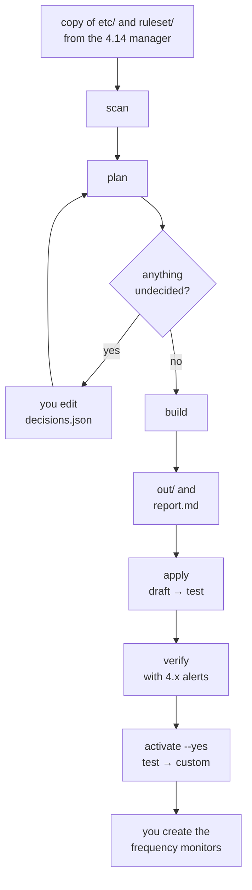
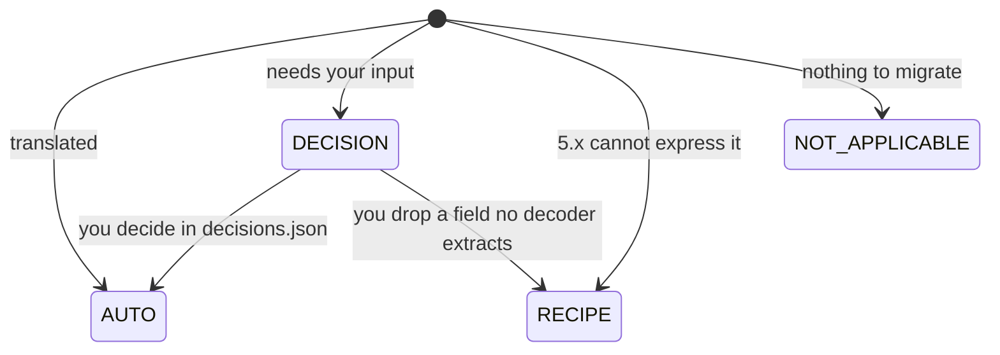
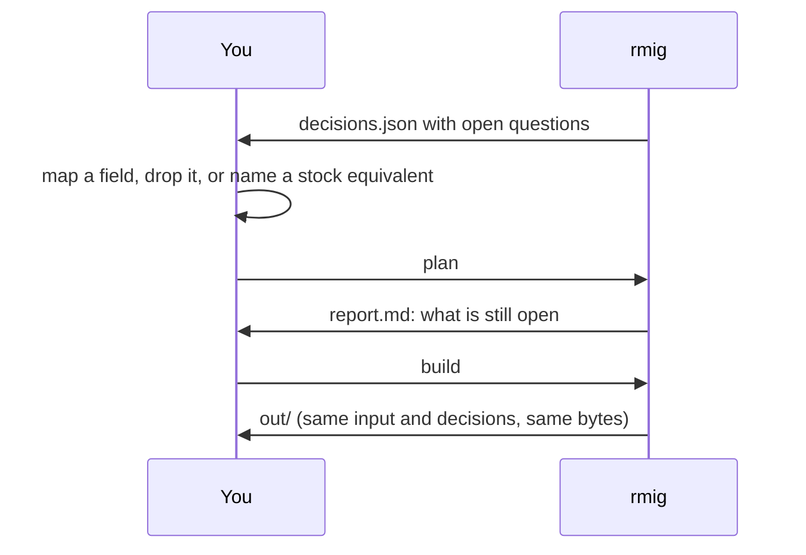

# Wazuh Ruleset Migration (4.14 to 5.x)-Wazuh Integration

## Table of Contents

* [Introduction](#introduction)
* [Provenance and maintenance](#provenance-and-maintenance)
* [Prerequisites](#prerequisites)
* [Installation and Configuration](#installation-and-configuration)
    * [Installing the migration tool](#installing-the-migration-tool)
    * [Initial migration tool configuration](#initial-migration-tool-configuration)
    * [Installing Wazuh (if applicable)](#installing-wazuh-if-applicable)
    * [Initial Wazuh Configuration (if applicable)](#initial-wazuh-configuration-if-applicable)
    * [Using the Integration Files](#using-the-integration-files)
* [Integration Steps](#integration-steps)
* [Integration Testing](#integration-testing)
* [Sources](#sources)
* [License](#license)
* [Copyright](#copyright)
* [Reason codes](#reason-codes)

---

### Introduction

Wazuh 5.x does not read the XML rules, XML decoders or CDB lists of Wazuh 4.x. This tool takes a copy of the
`etc/` directory of a 4.14 manager and turns the custom content into 5.x content: integrations, decoders, KVDBs and
Sigma rules. It loads that content into the Wazuh indexer, checks it against the alerts your 4.x manager raised and,
when you confirm, puts it in production.

The translation follows the official migration guides of wazuh/wazuh:
[rules](https://github.com/wazuh/wazuh/blob/main/docs/guide/migration/rules-4x-to-5x.md),
[decoders](https://github.com/wazuh/wazuh/blob/main/docs/guide/migration/xml-decoders-migration.md) and
[CDB lists](https://github.com/wazuh/wazuh/blob/main/docs/guide/migration/cdb-to-kvdb-migration.md).
The tool applies them the same way every time.

| The tool | The tool does not |
|---|---|
| Reads a copy of `etc/`; the 4.x manager can be off | Read or change the 4.x manager |
| Separates your custom content from the stock ruleset | Migrate the stock ruleset: 5.x ships its own |
| Translates what is mechanical | Guess: what it cannot know, it asks in `decisions.json` |
| Writes a recipe for each item 5.x cannot express | Approximate without saying so: every difference has a reason code |
| Loads your content into the `test` space and checks it with your 4.x alerts | Touch content someone else created in the indexer |
| Promotes to `custom` and creates detectors when you pass `--yes` | Create Alerting monitors: it writes their definitions |

---

### Provenance and maintenance

| Field | Value |
|---|---|
| Original source | Wazuh |
| Adapted by | Wazuh Threat Intelligence team |
| Tested versions | Wazuh 4.14.x (source) to Wazuh 5.0.0 (target) |
| Maintainer | Wazuh Threat Intelligence team |
| Support boundary | Community, provided as is. Run it on a test indexer first |

---

### Prerequisites

- Python 3.9 or later. Standard library only: nothing to install.
- A copy of `etc/` of a Wazuh **4.14** manager (`rules/`, `decoders/`, `lists/`, `ossec.conf`). A plain tree of
  rule and decoder files also works.
- The stock `ruleset/` directory of the same 4.x manager (`/var/ossec/ruleset`, or a copy of it). The tool ships
  no 4.x ruleset data: it reads yours to tell custom content from stock content. Without the manager at hand,
  use the `ruleset/` directory of a [wazuh/wazuh](https://github.com/wazuh/wazuh) checkout at the tag of your
  4.x version.
- For `apply`, `verify`, `activate` and `rollback`: the Wazuh 5.x indexer URL, a user that can use the Content
  Manager and Security Analytics APIs (`admin` or a `wazuh_admin` user), and the CA that signed the indexer
  certificate.
- Optional, for `verify`: the 4.x `alerts.json` files (`logs/alerts/`, also `.json.gz`).
- Optional, to check before 5.0 is installed (`verify --engine-socket`): a running 5.x engine (the standalone engine
  package, or a 5.0 manager) on Linux, and a 5.x catalog snapshot directory for rules over stock events. See
  [verify without an indexer](docs/reference.md#verify-without-an-indexer).

---

### Installation and Configuration

#### Installing the migration tool

Nothing to install. Run it from this folder:

```bash
python3 -m rmig --help
```

#### Initial migration tool configuration

Credentials are read from the environment or from a file, never from the command line, and never written to disk:

```bash
export WAZUH_INDEXER_URL=https://indexer.example:9200
export WAZUH_INDEXER_USER=admin
export WAZUH_INDEXER_PASSWORD='...'          # or --credentials-file FILE with one line user:password
```

How the tool treats hostile or sensitive input:

| Input | Behavior |
|---|---|
| Indexer URL | `https://` (or `http://`, with a warning on stderr: the password travels in clear text). A URL with a user or a password is refused; no message ever prints one. `--insecure` prints a warning |
| Indexer answers | A redirect (3xx) is never followed, so the credentials never go to another host. HTTP 429 (the Content Manager lock) is retried with an exponential wait, at most 30 s per call |
| Names from the input (decoder names, `decisions.json` integrations, list paths) | Every name that becomes an integration key, a resource, a file or an index name is a slug `[a-z0-9][a-z0-9_-]*` of at most 64 characters. A name already in that form is kept; any other gets a readable form plus 8 hex characters of its sha256 (`Foo` -> `foo-<hash>`). `build` refuses any `out/` file that would land outside `out/` (`RM-P-UNSAFE-PATH`, exit 2, nothing written) |
| Source tree | `rule_dir`, `decoder_dir`, `*_include` and list files are read only inside `--source`, symbolic links resolved; anything outside is skipped, printed by `scan` and kept in `work/inventory.json` (`conf_problems`) |
| `ossec.conf` secrets | Masked when read: every element and attribute whose name holds `pass`, `secret`, `token`, `key`, `auth`, `cred` or `hook`, integration `<options>`, every argument of `<command>`, `<full_command>` and `<extra_args>` except the program, plain flags and paths under a system directory or `etc/` (`PGPASSWORD=*** psql -h /tmp`), the user and path of every URL, `email_to` addresses. Nothing in `work/`, `report.json` or `out/references/` holds them |
| Report and terminal | Values copied from the input are escaped in Markdown (no HTML, links or images) and control characters are shown as `\xNN` |

#### Installing Wazuh (if applicable)

The tool needs no change to either manager. The source is a Wazuh 4.14 manager (only a copy of its `etc/` and
`ruleset/` is read). The target is a Wazuh 5.x indexer; see the
[Wazuh documentation](https://documentation.wazuh.com) to install one. Use a test indexer for the first runs.

#### Initial Wazuh Configuration (if applicable)

- `--stock-dir DIR`: the 4.x stock `ruleset/` directory. Default: the `ruleset/` of a `--source` that is a copy
  of the whole `/var/ossec`, else `/var/ossec/ruleset` when the tool runs on the 4.x manager (`scan` and `migrate`
  always reread it). `scan` caches its index in `work/stock-index.json`; `plan`
  and `build` reuse the cache. Without a stock ruleset the command stops with exit 2.
- Integrations that 5.x ships disabled must be enabled before rules on them can fire: the report names them.
- The working directory holds your rules, the index of your 4.x stock ruleset (`work/stock-index.json`) and the
  report. Secrets of `ossec.conf` are masked, but treat the directory as internal data before you share it.
- `build` replaces `<workdir>/out`. It refuses an `out/` directory that holds files and is not its own output.

#### Using the Integration Files

| Path | What it holds |
|---|---|
| `rmig/` | The tool (Python package, run with `python3 -m rmig`) |
| `rmig/data/` | 5.x side data: stock 5.x index, Windows field map, WCS fields, helper names, the `wazuh4-base` package, MITRE ATT&CK names |
| `examples/acmepay/` | A small 4.14 ruleset used in the example below |
| `scripts/` | Maintainer scripts: rebuild the 5.x index, inspect a stock index, regenerate the reason codes below |
| `docs/reference.md` | Every command in detail, the translation rules and the report sections |
| `tests/` | Offline test suite |
| `AGENTS.md` | Short guide for automated agents that run or change the tool |
| `NOTICE` | Third-party notices (MITRE ATT&CK, Elastic Common Schema) |

```text
rmig/
├── parse/        4.x readers: rules, decoders, CDB lists, <ruleset>
├── load_order.py the 4.14 load order and what is custom
├── tree.py       parent chains, silencers, state propagation
├── classify.py   states and reason codes; reasons.py is the catalog
├── translate/    rules, patterns, decoders, lists, monitors, helper dialects
├── emit/         out/ writer
├── api/          Content Manager client, apply, rollback
├── quality/      report sections: ossec.conf references, list classes, tuning, findings, what is not migrated
├── verify/       alerts reader and verification; engine client and Sigma reader of verify --engine-socket
├── activate/     test → custom and detectors
├── stock.py      index of the user's 4.x stock ruleset (built at run time)
├── stock5.py     offline "5.x stock for your sources" (report section)
└── data/         5.x side data (see above)
```

---

### Integration Steps

#### How it works



`scan`, `plan` and `build` work offline on your copy of `etc/`. `plan` writes `decisions.json`, the only file you
edit. `build` writes the 5.x content to `out/` and a report. `apply`, `verify` and `activate` talk to the Wazuh
indexer. Nothing reaches production until you run `activate --yes`.

Every rule, decoder and list ends in one of four states:



| State | Meaning | In `out/` |
|---|---|---|
| `AUTO` | Translated. `fidelity: exact`, or `approximate` with the difference named by a reason code | yes |
| `DECISION` | Translatable once you fill an entry of `decisions.json` | no, until you decide |
| `RECIPE` | No direct translation: `out/recipes/` explains what to do, and frequency rules get a monitor definition | the recipe |
| `NOT_APPLICABLE` | A stock list, a grouping rule, a rule 4.x itself discards | no |

A rule takes the worst state of its parent chain: the child of a frequency rule is a `RECIPE` too.

#### Example end to end

`examples/acmepay/` is a small 4.14 ruleset:

| File | What it holds |
|---|---|
| `etc/decoders/local_decoder.xml` | A decoder for a payment gateway, `acmepay`, with two children (`login`, `payment`) and custom fields |
| `etc/rules/local_rules.xml` | A grouping rule, a failed-login rule, a level 0 rule that silences the monitoring account, a frequency rule, a currency rule, a rule with a CDB list and a rule on top of stock rule 5716 (sshd) |
| `etc/lists/blocked-ips` | Two addresses and the prefix `192.0.2.` |
| `sample.log`, `alerts.json` | 17 log lines and the 14 alerts a 4.14.10 manager raised for them |
| `decisions.json` | The decisions of this walkthrough |

##### 1. Scan, plan and build

```bash
W=./acmepay-migration
python3 -m rmig migrate --source examples/acmepay/etc --stock-dir <4.x ruleset/> --workdir $W --engine-helpers 5.0
```

```text
scan: 8 rule(s), 3 decoder(s), 1 list(s) from 3 file(s) (etc layout)
build: AUTO 9, DECISION 1, RECIPE 1, NOT_APPLICABLE 1
build: 2 integration(s), 5 decoder(s), 1 kvdb(s), 4 rule(s), 1 monitor(s), 1 recipe(s) -> ./acmepay-migration/out
```

The exit code is 1: one item waits for a decision, rule 100300 on stock rule 5716. The custom fields have no WCS
field yet, but they do not block: a rule condition on such a field runs in the decoder that extracts it
(`RM-F-DECODER-CHECK`), and the value is not stored in the event (`RM-F-NOT-STORED`). `report.md` lists the open
questions and the values not stored, and `decisions.json` holds one entry per question:

```json
"fields": {
  "acmepay.currency": {"action": null, "wcs": null, "required": false, "used_by": ["decoder:acmepay-payment", "rule:100204"]},
  "acmepay.tenant":   {"action": null, "wcs": null, "required": false, "used_by": ["decoder:acmepay-login"]}
},
"stock": {
  "rule:5716": {"integration": null, "selection": null, "used_by": ["rule:100300"]}
}
```

`"required": false` marks an optional field: map it to keep its value. `decisions.json` also has a `lists` entry
for `etc/lists/blocked-ips`: rule 100205 alerts on a match of `srcip`, so the list is classified `ioc`. Its
`"action": null` keeps the KVDB, as in this walkthrough (see [Lists](#lists)).

##### 2. Decide once



In the example: `acmepay.tenant` → `organization.id`, `acmepay.merchant` → `organization.name`, `amount` and
`currency` are dropped (WCS has no field for them), the integration category is `applications`, and stock rule 5716
is the `system-auth` integration with `event.action: authentication-failure` and `process.name: sshd`.

```bash
cp examples/acmepay/decisions.json $W/decisions.json
python3 -m rmig plan  --workdir $W
python3 -m rmig build --workdir $W --source examples/acmepay/etc --engine-helpers 5.0
```

```text
plan: AUTO 10, DECISION 0, RECIPE 1, NOT_APPLICABLE 1
build: 3 integration(s), 5 decoder(s), 1 kvdb(s), 5 rule(s), 1 monitor(s), 1 recipe(s) -> ./acmepay-migration/out
```

One recipe remains: the frequency rule (100203). The currency field is dropped, so its value is not stored, but rule
100204 still checks it in the `acmepay-payment` decoder. `out/` now holds:

```text
out/
├── manifest.json, mapping.json, mapping.csv     4.x rule id → 5.x resource
├── integrations/
│   ├── wazuh4-base/          root decoder and the 4.x pre-decoding
│   ├── wazuh4-acmepay/       3 decoders, the blocked-ips KVDB, rules 100201, 100204, 100205, 100206
│   └── wazuh4-on-system-auth/  rule 100300, over the stock system-auth integration
├── monitors/100203.json       Alerting monitor definition for the frequency rule
├── references/                one JSON and one Markdown file per alerting block of ossec.conf
├── recipes/rule-100203.md
└── detectors/                 detector templates used by activate
```

##### 3. Apply to the test space

```bash
python3 -m rmig apply --workdir $W --ca root-ca.pem --dry-run    # prints the calls, writes nothing
python3 -m rmig apply --workdir $W --ca root-ca.pem
```

```text
apply: integration wazuh4-base
POST /_plugins/_content_manager/integrations  (create integration wazuh4-base)
...
POST /_plugins/_content_manager/promote  (promote wazuh4-acmepay draft -> test: 1 integrations, 1 kvdbs, 3 decoders, 3 rules)
apply: integration wazuh4-on-system-auth
...
apply: ok
```

Running `apply` again writes nothing. After a change in `out/`, it updates only what changed.

##### 4. Verify with the 4.x alerts

```bash
python3 -m rmig verify --workdir $W --ca root-ca.pem \
    --alerts examples/acmepay/alerts.json --samples examples/acmepay/samples
```

```text
verify: REPRODUCED 4, NOT_REPRODUCED 1, SILENCED 1, NOT_SILENCED 0, NO_SAMPLE 0
```

| 4.x rule | Result | Why |
|---|---|---|
| 100201 failed login | `REPRODUCED` 7/7 | |
| 100202 level 0, monitoring account | `SILENCED` | a level 0 rule has no alerts: its lines come from `samples/100202.log` |
| 100204 non-authorized currency | `REPRODUCED` 1/1 | the dropped `acmepay.currency` is checked in the `acmepay-payment` decoder |
| 100205 blocked address (list and prefix) | `REPRODUCED` 2/2 | |
| 100206 certificate expired | `REPRODUCED` 1/1 | |
| 100300 sshd outside 10.0.0.0/8 | `NOT_REPRODUCED` | 4.14 ignores the `!` of `<srcip>!10.0.0.0/8</srcip>` and alerted for 10.4.2.9. The migrated rule keeps the intent of the rule, so the results differ |

`verification.md` lists, per rule, the condition that did not hold. The exit code is 1 while a rule is
`NOT_REPRODUCED` or `NOT_SILENCED`.

##### 5. Activate

```bash
python3 -m rmig activate --workdir $W --ca root-ca.pem --yes
# activate: stopped: Activation needs a verification without failures ... Pass --force to activate anyway (recorded).
python3 -m rmig activate --workdir $W --ca root-ca.pem --yes --force
```

```text
POST /_plugins/_content_manager/promote  (promote test -> custom: 1 policy, 3 integrations, 1 kvdbs, 5 decoders, 4 rules)
POST /_plugins/_security_analytics/detectors  (create detector wazuh4-acmepay-1 (3 rules))
POST /_plugins/_security_analytics/detectors  (create detector wazuh4-on-system-auth-1 (1 rules))
activate: ok
```

Now `verify --via-detector` also runs the samples through a temporary detector built from the activated rules:

```bash
python3 -m rmig verify --workdir $W --ca root-ca.pem --alerts examples/acmepay/alerts.json \
    --samples examples/acmepay/samples --via-detector --limit 3
```

| 4.x rule | logtest | detector |
|---|---|---|
| 100201 | 3/3 | 3/3 |
| 100204 | 1/1 | 1/1 |
| 100205 | 2/2 | 2/2 |
| 100206 | 1/1 | 1/1 |
| 100300 | 0/1 | 0/1 |

With the same 17 log lines sent through a 5.x manager, the detectors produce 15 findings, against 14 alerts
in 4.14:

| Log | 4.14 alert | 5.x finding |
|---|---|---|
| failed login from a blocked address (×2) | 100205 | 100205 and 100201: 5.x reports every matching rule |
| failed login of the monitoring account | none | none |
| payment in XMR | 100204 | 100204: the currency is checked in the decoder; the title shows `<acmepay.currency>`, a dropped field has no value in 5.x |
| certificate expired | 100206 (level 7) | 100206 (`medium`) |
| failed login of `admin` ×8 | 100201 ×7, 100203 | 100201 ×8: create the monitor of `out/monitors/100203.json` |
| sshd from 198.51.100.23 | 5760 (stock) | 100300 `high` |
| sshd from 10.4.2.9 | 100300 | none: see the 100300 row of step 4 |

#### Commands

All commands take `--workdir` (default `./wazuh-ruleset-migration`). Exit codes: 0 done, 1 done with items waiting
for you (decisions, set-aside integrations, verification failures), 2 usage or environment error, or a stop that
protects content (see the `RM-P-*` codes).

| Command | Reads | Writes | Network |
|---|---|---|---|
| `scan --source DIR [--stock-dir DIR]` | copy of `etc/` or a tree of rule files | `work/inventory.json` | no |
| `plan` | inventory, `decisions.json` | `work/plan.json`, `decisions.json`, `report.md`, `report.json` | no |
| `build --source DIR [--engine-helpers V] [--engine-limit NAME=N]` | plan, decisions, list files | `out/`, report | no |
| `migrate --source DIR [--stock-dir DIR] [--engine-helpers V]` | as `scan` + `plan` + `build` | as those | no |
| `stats [--source DIR]` | workdir or a tree | a table on screen | no |
| `apply [--dry-run] [--engine-limit NAME=N]` | `out/`, `work/state.json` | your content in `draft` and `test` | yes |
| `verify --alerts FILE... [--samples DIR] [--limit N] [--via-detector]` | `out/`, state, 4.x alerts | `verification.md`, `verification.json` | yes |
| `verify --engine-socket PATH --alerts FILE... [--catalog DIR] [--samples DIR] [--limit N]` | `out/`, 4.x alerts, a 5.x catalog snapshot | `verification-offline.md`, `verification-offline.json` | the engine's unix socket only |
| `activate --yes [--force] [--dry-run]` | state, last verification | your content in `custom`, detectors | yes |
| `rollback [--yes] [--dry-run]` | state | removes your content from `draft` and `test`; with `--yes` from `custom` and the detectors too | yes |

Each command in detail, the translation rules (rules, patterns, decoders, feeds, lists, Windows content) and
the report sections are in [docs/reference.md](docs/reference.md).

#### Limitations

- Source: Wazuh 4.14.x only. `ossec.conf` settings other than `<ruleset>` are not migrated: the report lists them
  with the guide that covers each one.
- Correlation (`if_matched_sid`, `same_*` and `different_*` without a frequency monitor), first time seen (`if_fts`,
  `fts`), `check_diff`, `<time>`, `<weekday>` and `compiled_rule` have no 5.x equivalent: they are recipes.
- The stock equivalence table (`rmig/data/stock-equivalence-4.14.json`) is empty for now. Custom rules on top of
  stock rules other than the Windows ones (see [Windows content](docs/reference.md#windows-content)) need an entry in
  `decisions.json` (`stock`). Rules on the stock JSON decoder are [feeds](docs/reference.md#feeds).
- Windows: 4.x drops EventData values `-` and `(NULL)`; 5.x keeps them. A condition that only tests that a field
  exists can differ on those values. 4.x `win.*` values keep the JSON escaping (two backslashes per path separator,
  as the stock 4.14 rules expect); 5.x stores one. The migration makes each pair of literal backslashes in a `win.*`
  pattern one (`SpecialAccounts\\\\UserList` matches `SpecialAccounts\UserList`). Sysmon event ids with no recorded event (8, 10 and others) map fewer fields.
- 5.x has no free-form field: a custom field with no WCS equivalent is not stored in the event. Rules over generated
  decoders and feeds still check it in the decoder; rules over stock content need a mapping.
- An OS_Regex or OS_Match pattern with `[...]`, `.*` after a literal or `{n}` matches those characters as text in 4.x.
  The migration keeps that meaning and warns (`RM-X-LITERAL-SYNTAX`).
- `verify` before `activate` relies on logtest, which differs from the live detector in regular expressions and
  letter case. The emitted rules avoid the forms that differ; `--via-detector` after `activate` checks the rest.
- `verify --engine-socket` checks the rules with the tool's own Sigma reader, not with Security Analytics. Its
  verdicts match the indexer's on the recorded verification runs (`tests/data/verify-equivalence/`); what it does not cover is
  `NOT_CHECKED`. Frequency and correlation rules (Alerting monitors) are not checked in either mode. The policy
  document the tool sends for `out/` has the fields of the indexer's own; the indexer may add others.
- `activate` promotes only the tool's content. When the test space has changes someone else made that are not in
  custom yet, it stops and lists them (type, id and title). `--include-foreign-changes` promotes them to custom
  too, and the run records it.
- Rules with `no_full_log`: their 4.x alerts have no original log line, so `verify` cannot replay them. The report
  lists them; give sample lines with `verify --samples DIR`.
- A draft policy root other than the standard `decoder/core-wazuh-message/0` stops `apply` (`RM-P-ROOT-OWNED`). Under
  the standard root, the predecoder check is a superset of its children's selection; the engine's sibling order
  decides whether it is tried before the user's decoders (see [Shared root decoder](docs/reference.md#shared-root-decoder)).
- Default content: 5.x replaces the stock ruleset with its own. `report.md` names the stock rules your content used
  that have no equivalent and the 5.x integrations it depends on; integrations that ship disabled must be enabled.

---

### Integration Testing

On your data: `verify` replays your 4.x alerts against the migrated content in the `test` space and writes
`verification.md` (see [verify](docs/reference.md#verify)). Before 5.0 is installed, `verify --engine-socket` gives the same check
against a 5.x engine (see [verify without an indexer](docs/reference.md#verify-without-an-indexer)). The example
`examples/acmepay/` walks through every step with its expected output.

The tool's own tests run offline. From the `tests/` folder:

```bash
python3 -m unittest discover -s . -q                       # no network; a fake indexer fails forbidden calls
RMIG_STOCK_DIR=<checkout of wazuh 4.14.x> RMIG_CORPUS_DIR=<rules tree> python3 -m unittest discover -s . -q
RMIG_UPDATE_GOLDEN=1 python3 -m unittest discover -s . -q   # rewrite tests/golden after an intended change
```

The suite uses a small synthetic stock ruleset (`tests/data/stock-mini/`). Tests that need the real 4.14 ruleset
run only with `RMIG_STOCK_DIR`.

Maintainer scripts, from this folder:

```bash
python3 scripts/build_stock_index.py --stock-dir <4.x ruleset/> --out <file>   # inspect the stock index migrate builds
python3 scripts/build_stock5_index.py <5.x catalog snapshot>             # rmig/data/stock5-index.json
python3 scripts/gen_reason_codes_doc.py [--check]               # regenerate the reason codes section below
```

---

### Sources

- Wazuh 4.x to 5.x migration guides: [rules](https://github.com/wazuh/wazuh/blob/main/docs/guide/migration/rules-4x-to-5x.md),
  [decoders](https://github.com/wazuh/wazuh/blob/main/docs/guide/migration/xml-decoders-migration.md),
  [CDB lists](https://github.com/wazuh/wazuh/blob/main/docs/guide/migration/cdb-to-kvdb-migration.md).
- [Wazuh documentation](https://documentation.wazuh.com).
- [MITRE ATT&CK](https://attack.mitre.org) (technique names in `rmig/data/mitre.json`).
- [Elastic Common Schema](https://github.com/elastic/ecs) (the ECS part of `rmig/data/wcs-fields.csv`).

---

### License

This tool is part of the Wazuh Integrations repository and is distributed under its license, the GNU Affero
General Public License v3.0 (AGPL-3.0). Third-party data and its notices are listed in [NOTICE](NOTICE).

---

### Copyright

Copyright (C) 2015-2026, Wazuh Inc.

---

## Reason codes

Generated from `rmig/reasons.py` by `scripts/gen_reason_codes_doc.py`. The links in `report.md` point here.

<!-- reason-codes:begin -->
<!-- Generated by scripts/gen_reason_codes_doc.py from rmig/reasons.py: do not edit by hand. -->

A code reads `RM-<scope>-<name>`. **State** is the state the code gives the item (the item takes the highest
of its codes). **Propagates** `yes`: a child rule of an item with this code gets it too. **Fidelity**
`approximate`: an `AUTO` item with this code is equivalent except for the named difference.

### Rules

#### RM-R-FREQUENCY

State `RECIPE` · propagates yes · fidelity -. The rule counts events (frequency/timeframe). 5.x rules have no state: an Alerting monitor replaces it.

#### RM-R-CORRELATION

State `RECIPE` · propagates yes · fidelity -. The rule correlates events (if_matched_*, different_*, global_frequency). 5.x rules have no state: no direct translation.

#### RM-R-FTS

State `RECIPE` · propagates yes · fidelity -. The rule uses first-time-seen (if_fts), which keeps state in 4.x. No direct translation.

#### RM-R-CHECK-DIFF

State `RECIPE` · propagates yes · fidelity -. The rule compares the event with the previous one stored on disk (check_diff). No direct translation.

#### RM-R-TIME

State `RECIPE` · propagates yes · fidelity -. The rule depends on the time of day or the weekday (time, weekday). Not supported in 5.x rules.

#### RM-R-COMPILED

State `RECIPE` · propagates yes · fidelity -. The rule calls C code (compiled_rule). No declarative translation.

#### RM-R-IGNORE

State `AUTO` · propagates no · fidelity approximate. The rule throttles or suppresses repeated alerts (ignore, check_if_ignored). 5.x has no equivalent: the migrated rule fires every time.

#### RM-R-OPTIONS

State `AUTO` · propagates no · fidelity exact. The rule sets alert options (options, maxsize) that 5.x rules do not have. They are listed as a note.

#### RM-R-GROUPING-ONLY

State `NOT_APPLICABLE` · propagates no · fidelity -. The rule only groups its children (level 0, no condition of its own). It is not emitted; its children carry its conditions.

#### RM-R-SILENCER-STOCK

State `RECIPE` · propagates no · fidelity -. Level 0 rule that silences stock rules. Stock content cannot be changed: the exclusion is written in the recipe.

#### RM-R-OVERWRITE-STOCK

State `RECIPE` · propagates yes · fidelity -. The rule changes a stock rule (overwrite, or a modified copy of a stock file). Stock content cannot be changed in 5.x.

#### RM-R-SHADOWING

State `AUTO` · propagates no · fidelity approximate. In 4.x only one rule alerts per event; in 5.x every matching rule produces a finding. This rule can now fire together with a parent or a sibling.

#### RM-R-NO-SOURCE

State `RECIPE` · propagates yes · fidelity -. Nothing ties the rule to a log source (no decoded_as and no parent rule that has one). It cannot be assigned to an integration.

#### RM-R-IF-LEVEL

State `RECIPE` · propagates yes · fidelity -. The rule hangs from every rule of a minimum level (if_level). No translation.

#### RM-R-RE-DIALECT

State `AUTO` · propagates no · fidelity approximate. A pattern uses a construct with no exact form in the detector's regex dialect.

#### RM-R-LONG-MESSAGE

State `AUTO` · propagates no · fidelity approximate. Samples are longer than 4096 bytes: the message field is not indexed above that size.

#### RM-R-OFFLINE-ENGINE

State `AUTO` · propagates no · fidelity exact. verify --engine-socket: the events ran through a 5.x engine with no indexer and the tool's own Sigma reader gave the rule verdicts (verification-offline.md). A check before 5.0 is installed; the final proof is verify on the 5.0 indexer, and activate reads only that one.

#### RM-R-NOT-CHECKED

State `AUTO` · propagates no · fidelity exact. verify --engine-socket gave no verdict for the rule: it uses a form the local Sigma reader does not cover (or one whose meaning differs between logtest and the detector), or its events need content this engine does not have (stock decoders without --catalog, IoC enrichment). The detail names it. Run verify on the 5.0 indexer for it.

#### RM-R-PARENT-RECIPE

State `RECIPE` · propagates yes · fidelity -. A parent rule is RECIPE, so this rule cannot be translated on its own either.

#### RM-R-DUPLICATE-ID

State `NOT_APPLICABLE` · propagates no · fidelity -. Another rule with the same id was loaded first and this one has no overwrite: 4.x ignores it.

#### RM-R-FILE-SHADOWED

State `NOT_APPLICABLE` · propagates no · fidelity -. The file is not loaded by 4.x (rule_exclude matches its path or base name, or the rule_dir pattern does not match).

#### RM-R-PARENT-NOT-LOADED

State `NOT_APPLICABLE` · propagates yes · fidelity -. No parent named by if_sid, if_group or if_level is loaded before this rule: 4.x discards it.

#### RM-R-TITLE-SUFFIXED

State `AUTO` · propagates no · fidelity exact. Two migrated rules share the description: the title gets the suffix ' (4.x rule `<id>`)'.

#### RM-R-LABEL-UNAVAILABLE

State `RECIPE` · propagates yes · fidelity -. The condition needs a tag set by a decoder of the migration, but the events come from a stock integration.

#### RM-R-STOCK-COPY

State `NOT_APPLICABLE` · propagates no · fidelity -. The rule is identical to the stock rule with the same id: it is stock content, not custom.

#### RM-R-OVERWRITE-MERGED

State `NOT_APPLICABLE` · propagates no · fidelity -. The rule overwrites a custom rule loaded before it: its content is translated there.

#### RM-R-SILENCER

State `AUTO` · propagates no · fidelity exact. Level 0 rule that stops other rules from alerting. It is not emitted: its condition becomes an exclusion on the rules it silenced in 4.x.

#### RM-R-RE-UNSUPPORTED

State `RECIPE` · propagates yes · fidelity -. A pattern has no form in the detector's regex dialect nor in a decoder label (see the detail), or the dialect validator refused it. The rule is not emitted.

#### RM-R-MULTI-SOURCE

State `RECIPE` · propagates yes · fidelity -. The chains of the rule reach more than one log source (integration); a 5.x rule belongs to one integration.

#### RM-R-FEED

State `AUTO` · propagates no · fidelity approximate. The rule belongs to a feed: its root rule takes its events by `<location>`, by `<field>` conditions, or by the stock JSON decoder, not by a custom decoder. A generated decoder selects the events of the feed (decisions.json, feeds) and the rule keeps the conditions of its root. In 4.x the first root rule that matched took the event; in 5.x the first feed decoder whose selector matches takes it. Feeds without JSON are tried after the migrated decoders; JSON feeds hang from the recreated 4.x JSON decoder, which is tried before them, as the stock JSON decoder loads before custom decoders in 4.x.

#### RM-R-FEED-LOCATION

State `AUTO` · propagates no · fidelity approximate. The feed selects its events by wazuh.protocol.location, the 5.x field of the 4.x location. That 5.x fills it with the same value as 4.x for module and socket feeds (and without the agent prefix 4.x adds) is not proven.

#### RM-R-FEED-NO-SELECTOR

State `DECISION` · propagates yes · fidelity -. The feed has no condition that can select its events in a decoder (see the detail), and another feed already takes every JSON event. Write the selector (a decoder check) in decisions.json (feeds).

### Fields

#### RM-F-UNMAPPED

State `DECISION` · propagates yes · fidelity -. A field the rule or decoder uses has no WCS destination yet. Complete it in decisions.json (fields).

#### RM-F-DROPPED

State `RECIPE` · propagates yes · fidelity -. A field the rule depends on is marked drop in decisions.json.

#### RM-F-TYPE

State `AUTO` · propagates no · fidelity approximate. A value of the field does not convert to its WCS type: the field stays unmapped for that value.

#### RM-F-DECODER-CHECK

State `AUTO` · propagates no · fidelity exact. A condition on a field with no WCS destination runs in the generated decoder that extracts the field, with the 4.x matching (OS_Match, OS_Regex or PCRE2, letter case, negate), and sets a tag that the rule matches. The rule matches the same events. The value is not stored in the event: map the field in decisions.json (fields) to keep it.

#### RM-F-NOT-STORED

State `AUTO` · propagates no · fidelity approximate. The decoder extracts a field with no WCS destination yet: rules can still check it (RM-F-DECODER-CHECK), but its value is not stored in the event. Map it in decisions.json (fields) to keep it.

#### RM-F-JSON-PATH

State `RECIPE` · propagates yes · fidelity -. A JSON key the rule uses has characters that a 5.x field path cannot hold (see the detail): the feed decoder cannot read it.

### Stock content

#### RM-S-NO-EQUIVALENT

State `DECISION` · propagates no · fidelity -. The rule depends on stock 4.x content (a decoder, rule or group) with no entry in the equivalence table. Complete decisions.json (stock).

#### RM-S-INTEGRATION-DISABLED

State `AUTO` · propagates no · fidelity exact. The stock 5.x integration this content depends on ships disabled: enable it.

#### RM-S-INVALID-ENTRY

State `DECISION` · propagates no · fidelity -. The decisions.json or equivalence entry for the stock content cannot be used (see the detail): fix it in decisions.json (stock).

#### RM-S-UNKNOWN-INTEGRATION

State `AUTO` · propagates no · fidelity approximate. decisions.json names a stock integration that the tool's snapshot of the 5.x catalog does not list: category 'other' is assumed. Check the name and the category.

#### RM-S-BROAD-SELECTION

State `AUTO` · propagates no · fidelity approximate. The stock decoder is selected only by its 5.x integration: the rule can also match events of other programs of that integration.

#### RM-S-WIN-APPROXIMATE

State `AUTO` · propagates no · fidelity approximate. A Windows condition uses an equivalent of the Windows pack that is not exact (see the detail: a value table or a field map entry with a known difference).

#### RM-S-WIN-FULL-LOG

State `RECIPE` · propagates no · fidelity -. `<match>` or `<regex>` on a Windows event: 4.x reads the event as JSON, 5.x has the original XML in event.original. Key syntax, separators and escaping differ: rewrite the condition on the WCS fields.

#### RM-S-WIN-CONDITION

State `DECISION` · propagates no · fidelity -. A condition of the stock Windows chain has no 5.x field in the Windows pack. Complete decisions.json (stock).

#### RM-S-WIN-DISCARDED

State `RECIPE` · propagates no · fidelity -. The 5.x Windows base decoder discards the events of this event id: the rule cannot fire in 5.x.

### Decoders

#### RM-D-PLUGIN

State `RECIPE` · propagates yes · fidelity -. The decoder runs C code (plugin_decoder). No declarative translation.

#### RM-D-FTS

State `RECIPE` · propagates yes · fidelity -. The decoder declares first-time-seen fields (fts), which keep state in 4.x.

#### RM-D-ACCUMULATE

State `RECIPE` · propagates yes · fidelity -. The decoder merges fields across events (accumulate), which keeps state in 4.x.

#### RM-D-JSON-CATCHALL

State `DECISION` · propagates yes · fidelity -. The decoder accepts any JSON event. Write the check that selects its events in decisions.json (integrations, json_check).

#### RM-D-REGEX-DIALECT

State `AUTO` · propagates no · fidelity approximate. A decoder pattern uses a construct with no exact RE2 form.

#### RM-D-STOCK-PARENT

State `DECISION` · propagates yes · fidelity -. The parent decoder is stock and is not available to recreate in the base integration yet.

#### RM-D-REGEX-UNSUPPORTED

State `RECIPE` · propagates yes · fidelity -. A decoder pattern uses a PCRE2 construct that RE2 does not have (see the detail).

#### RM-D-DUAL-DOCUMENT

State `AUTO` · propagates no · fidelity exact. Events this decoder accepts are indexed twice: once by the standard policy and once by the custom policy.

#### RM-D-STOCK-COPY

State `NOT_APPLICABLE` · propagates no · fidelity -. The decoder is identical to the stock decoder with the same name: it is stock content, not custom.

#### RM-D-PARENT-NOT-LOADED

State `NOT_APPLICABLE` · propagates no · fidelity -. The parent decoder is not loaded before this one: 4.x refuses it.

#### RM-D-HELPER-UNAVAILABLE

State `RECIPE` · propagates yes · fidelity -. The translation calls an engine helper that the target engine (--engine-helpers) does not register, or has no form of it in that engine's names (see the detail). It is not emitted.

#### RM-D-FILE-SHADOWED

State `NOT_APPLICABLE` · propagates no · fidelity -. The file is not loaded by 4.x (decoder_exclude matches its path or base name, or the decoder_dir pattern does not match).

#### RM-D-SHADOWED-ROOT

State `AUTO` · propagates no · fidelity approximate. The root decoder of this item never matches in 4.x: a root decoder loaded earlier (see the detail) accepts every event it accepts. In 4.x the decoder, its children and the rules that depend on it never applied. If the winner is custom, 5.x keeps the 4.x order and they do not apply there either; if it is stock, the custom policy does not have it and the migrated content can produce findings that 4.x never raised. Check that it is still wanted.

#### RM-D-SHADOWED-LIKELY

State `AUTO` · propagates no · fidelity approximate. Possibly shadowed by a stock 4.x decoder, confirm: a stock root decoder loaded earlier (see the detail) may take the events of this item's root decoder (every distinctive literal of its prematch is in this one's prematch, in order). Not proven offline. If it does, in 4.x this decoder, its children and the rules under it never applied, and 5.x would raise findings 4.x never raised. Check with a sample event in 4.x logtest that it is still wanted.

#### RM-D-FEED-JSON

State `AUTO` · propagates no · fidelity approximate. The feed decoder parses the event as JSON (as the 4.x JSON decoder) and reads each key by its path. 4.x joins nested keys with dots, compares every value as text (integers as %i, other numbers with 6 decimals, true, false, null, arrays as JSON text) and ignores the letter case of field names; 5.x keeps the JSON types, reads a dotted key as nested objects and compares names exactly. A rule root without decoded_as is assumed to read fields of the 4.x JSON decoder.

### Lists

#### RM-L-STOCK

State `NOT_APPLICABLE` · propagates no · fidelity -. The list has the same content as a stock list: nothing to migrate.

#### RM-L-PREFIX-KEYS

State `AUTO` · propagates no · fidelity approximate. The list has network prefix keys (ending in '.'): they become ip_cidr_match lookups (IPv4 only).

#### RM-L-KEY-VALUE-INVERTED

State `RECIPE` · propagates yes · fidelity -. address_match_key_value has its condition inverted in 4.14 compared with match_key_value. Review it by hand.

#### RM-L-IOC-FEED

State `AUTO` · propagates no · fidelity approximate. decisions.json moves this IoC list to the 5.x IoC feeds: the lookup becomes a match on wazuh.threat.enrichments.indicator.type (the wazuh-ioc enrichment). Entries of the list that no feed has are lost, and an indicator found in any field of the event matches. Not live-verified.

#### RM-L-IOC-FEED-UNSUPPORTED

State `RECIPE` · propagates yes · fidelity -. decisions.json moves this list to the 5.x IoC feeds, but the lookup (negated, with a value check, or of a list with no feed type) has no form on the IoC enrichment. Keep the KVDB (action kvdb) or rewrite the rule by hand.

#### RM-L-MISSING

State `NOT_APPLICABLE` · propagates yes · fidelity -. The list is not declared in `<ruleset><list>`, or its file is missing: 4.x discards the rule that uses it.

### Policy and spaces

#### RM-P-ROOT-OWNED

State `RECIPE` · propagates no · fidelity -. The policy already has a root decoder that the tool did not set and that does not do what the standard decoder/core-wazuh-message/0 does (see the detail): it is never changed. Migrate into a policy without a custom root decoder, or merge by hand.

#### RM-P-SHARED-ROOT

State `AUTO` · propagates no · fidelity approximate. The draft policy already has the standard root decoder decoder/core-wazuh-message/0: the tool's decoders hang from it and the policy is not changed. The predecoder gets a check built from its child decoders, each test moved onto event.original: it accepts every event they accept, and a few more, which then end in wazuh4-base instead of a later sibling. The tool's integrations go first in the draft policy, so the predecoder is tried before the standard decoders that hang from the same root (decoder/syslog/0 takes every syslog line).

#### RM-P-ROOT-CATCHALL

State `RECIPE` · propagates no · fidelity -. The tool can share the draft policy's root decoder, but a migrated decoder under the predecoder has no test that can limit the predecoder to its logs (see the detail): under a shared root the predecoder would take every event before the user's decoders. Nothing was changed. Migrate into a policy without a root decoder, or give the 4.x decoder a program_name or prematch.

#### RM-P-NAME-CONFLICT

State `RECIPE` · propagates no · fidelity -. A resource with the same name exists in the space and is not owned by the tool.

#### RM-P-FOREIGN-POLICY-CHANGE

State `RECIPE` · propagates no · fidelity -. The draft policy has changes that the tool did not make.

#### RM-P-POLICY-LOCKED

State `RECIPE` · propagates no · fidelity -. The policy cannot be written (403).

#### RM-P-ENGINE-LIMIT

State `RECIPE` · propagates no · fidelity -. The content exceeds a limit of the 5.x indexer (see the detail): raise the cluster setting or migrate in parts.

#### RM-P-UNCLASSIFIED-INDEXED

State `RECIPE` · propagates no · fidelity -. The custom policy indexes unclassified events: base events would be indexed.

#### RM-P-UNSAFE-PATH

State `RECIPE` · propagates no · fidelity -. A file of out/ would be written outside out/ (a name of the input that is not a plain file name). Nothing was written.

#### RM-P-SECOND-POLICY

State `AUTO` · propagates no · fidelity exact. Generated decoders add a second active policy: every event of the manager also goes through it.

### General

#### RM-X-UNKNOWN-ELEMENT

State `RECIPE` · propagates yes · fidelity -. The element or attribute is unknown to 4.14 (analysisd would refuse the file). Review it by hand.

#### RM-X-INVALID

State `RECIPE` · propagates yes · fidelity -. 4.14 would reject this element (see the detail). Review it by hand.

#### RM-X-LITERAL-SYNTAX

State `AUTO` · propagates no · fidelity approximate. A 4.x OS_Regex or OS_Match pattern has regular expression syntax that 4.x reads as plain text: a class [...], .* or .+ after a literal, or a {n} count (see the detail). The translation keeps the 4.x meaning, so the pattern matches what it matched in 4.x, which is probably not what its author intended. Check it.

#### RM-X-PROVISIONAL-AUTO

State `AUTO` · propagates no · fidelity exact. No construct that blocks the translation was found. The item is AUTO until the translator confirms it.

#### RM-X-TRANSLATED

State `AUTO` · propagates no · fidelity exact. Translated with no difference from 4.x that the tool knows of.

<!-- reason-codes:end -->
