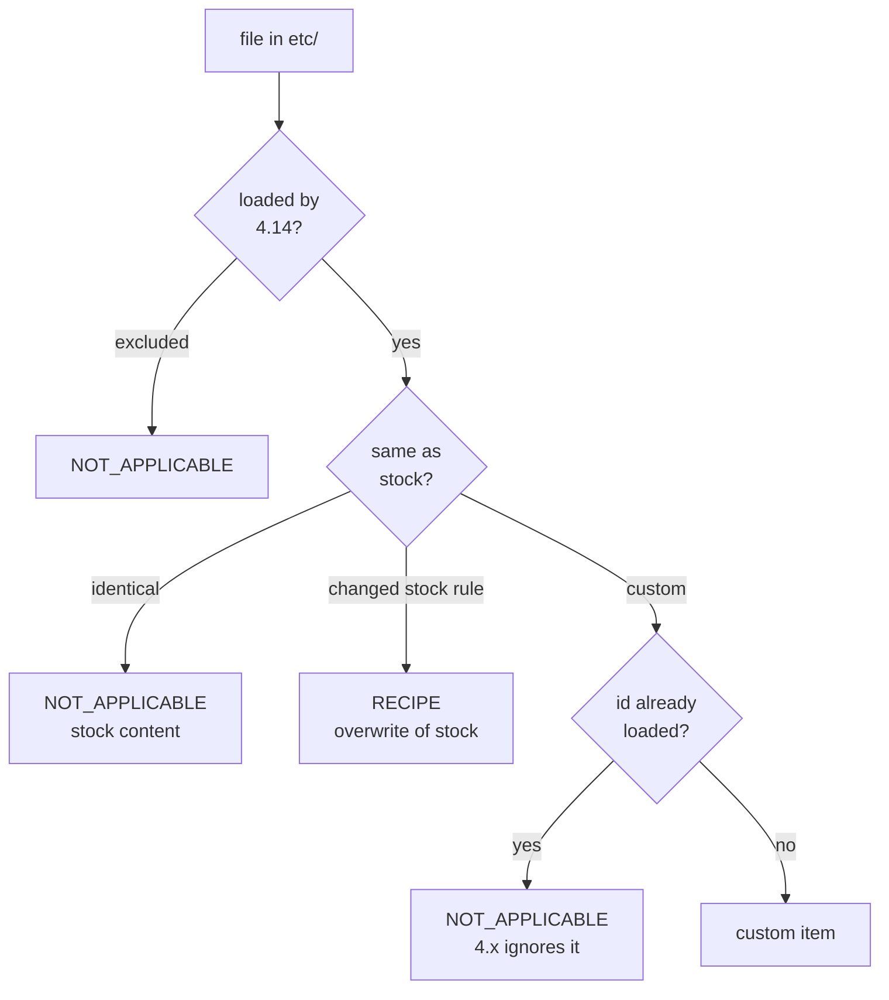
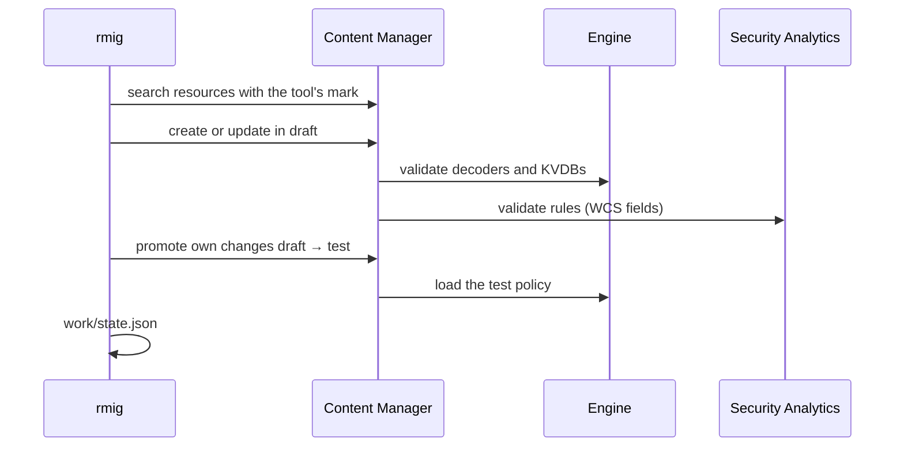
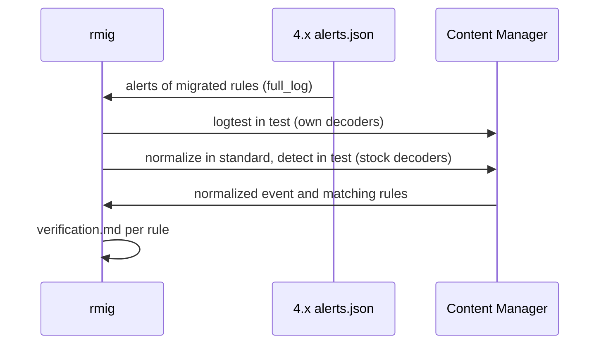
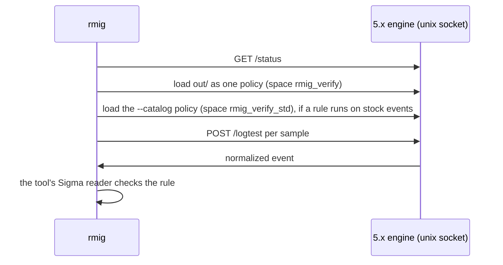
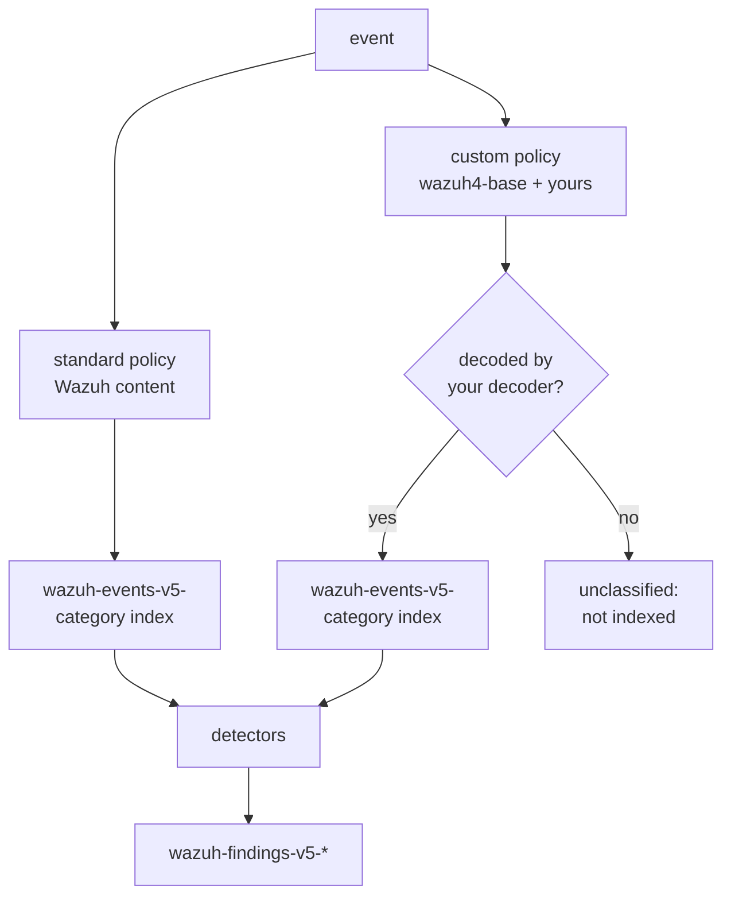
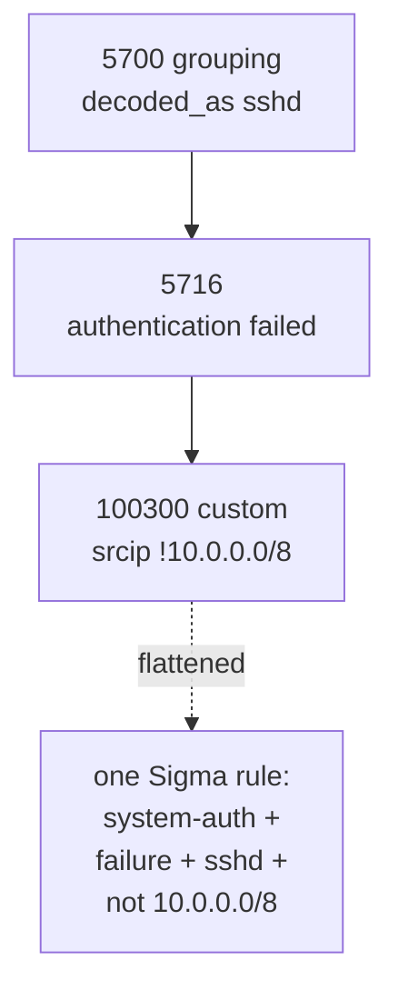
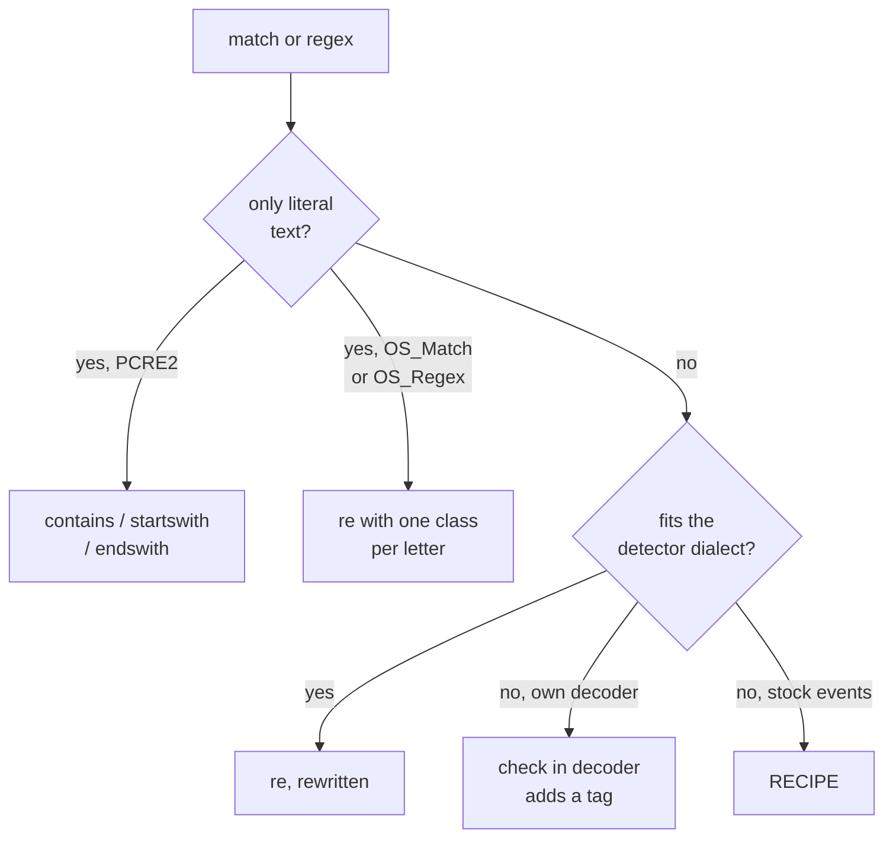
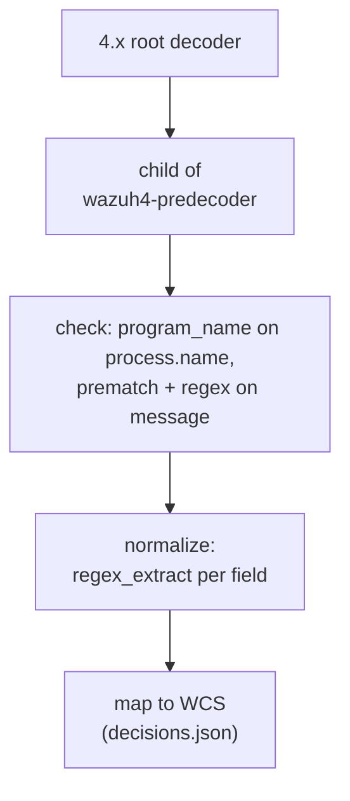
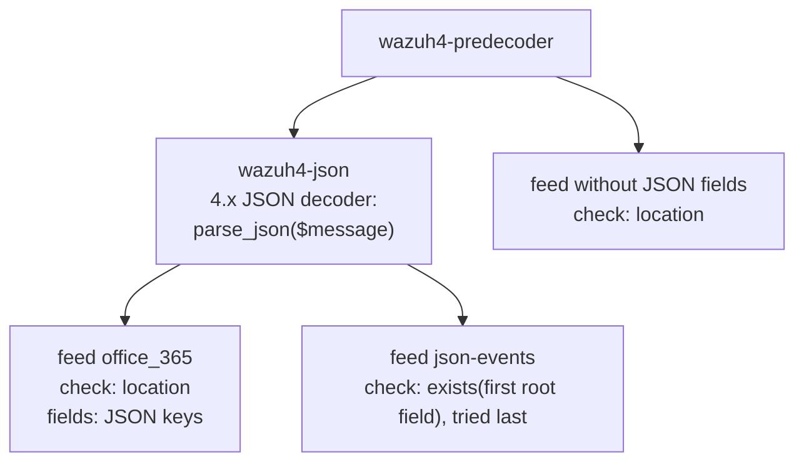
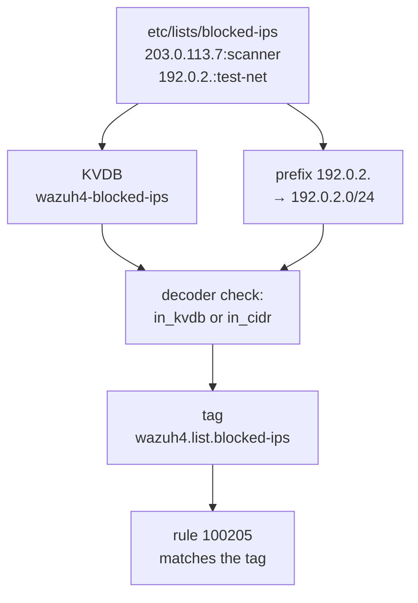

# Wazuh Ruleset Migration: reference

The commands in detail, how 4.x content is translated, and what the report adds. Start with the
[README](../README.md).

## Commands

### scan

Reads `ossec.conf` (`<ruleset>`: `rule_dir`, `rule_exclude`, `decoder_dir`, `list`; the alerting blocks and the
other sections only for the report, see [What the report adds](#what-the-report-adds)) and loads the files in the
order a 4.14 manager loads them, with the stock ruleset in between. The stock ruleset is the user's own 4.x
`ruleset/` directory (`--stock-dir DIR`, default `/var/ossec/ruleset` when it exists): no 4.x ruleset data ships
with the tool. `scan` indexes it and caches the index in `work/stock-index.json`; `plan` and `build` reuse the cache.
Without a stock ruleset the command stops with exit 2. That is how it tells custom content from stock content:



```bash
python3 -m rmig scan --source /backup/ossec-etc --workdir W
python3 -m rmig scan --source ./my-rules-repo --workdir W    # a loose tree: rule and decoder files found by content
```

### plan

Classifies and translates every item and writes the report. Run it after every change to `decisions.json`. It never
loses or reorders what you wrote; new questions are added in alphabetical order. A WCS field name that does not
exist is rejected (exit 2) with its name.

`decisions.json` has three sections, `feeds` when the ruleset has feeds, and `lists` when a list looks like threat
intelligence:

| Section | Entry | Values |
|---|---|---|
| `fields` | a custom decoder field (`myapp.user_id`) | `"action": "map", "wcs": "<WCS field>"` or `"action": "drop"`. `"required": false`: optional, the decoders check the field without it; map it to keep the value |
| `integrations` | an integration made from a custom root decoder | `"category"`: one of `security`, `system-activity`, `cloud-services`, `applications`, `network-activity`, `access-management`, `other` |
| `stock` | a stock rule, group or decoder your content hangs from (`rule:5716`) | `"integration": "<5.x integration>", "selection": {<WCS field>: <value>}` |
| `feeds` | a root rule tied to its events by `<location>`, `<field>` or the stock JSON decoder (`108000`) | `"integration"`, `"category"` and `"selector"` (a decoder check; `null` uses `default_selector`). See [Feeds](#feeds) |
| `lists` | a CDB list classified `ioc` that rules use | `"action"`: `null` or `"kvdb"` (default: a KVDB, as before) or `"ioc-feed"` (the rules match the 5.x IoC enrichment). See [Lists](#lists) |

### build

Writes `out/`. `--engine-helpers` selects the helper names of the target engine: `5.0` (default) or `5.0-rc1` (the
names before wazuh/wazuh#41150, such as `ip_cidr_match` and `kvdb_match`). A helper the target does not have is
never emitted: the item becomes a `RECIPE` (`RM-D-HELPER-UNAVAILABLE`).

```bash
python3 -m rmig build --workdir W --source /backup/ossec-etc --engine-helpers 5.0-rc1
```

#### Engine limits

`plan` and `build` check the content against the limits of the 5.0 indexer and print a warning per limit exceeded.
`report.md` (Engine limits) and `report.json` (`build.limits`) list, per integration, the rules, decoders, KVDBs,
detectors and the largest decoder body, and each limit exceeded with its setting and the action. All the settings
are dynamic cluster settings; the values are their defaults.

| Limit | Default | Setting | Counted over |
|---|---:|---|---|
| `max_rules` | 200 | `plugins.content_manager.max_rules` | the whole draft space |
| `max_decoders` | 200 | `plugins.content_manager.max_decoders` | the whole draft space |
| `max_integrations` | 100 | `plugins.content_manager.max_integrations` | the whole draft space |
| `max_kvdbs` | 100 | `plugins.content_manager.max_kvdbs` | the whole draft space |
| `max_rules_per_detector` | 50 | `plugins.security_analytics.max_rules_per_detector` | one detector |
| `max_detectors` | 10 | `plugins.security_analytics.max_detectors` | user-created detectors of the cluster |
| `decoder_body_bytes` | 50000 | none known (HTTP 413 seen live) | the body of one decoder create |

The draft space and the cluster may already hold content: the report counts only this build. `apply` counts what
is in draft now plus what it still has to create, and stops before any write when a limit would be exceeded
(`RM-P-ENGINE-LIMIT`). If a raised `decoder_body_bytes` is still above what the indexer accepts, its HTTP 413
sets that integration aside like any other refusal. Raise the setting with `PUT _cluster/settings`, then pass `--engine-limit NAME=N` (repeatable)
to `plan`, `build`, `migrate` and `apply`; or migrate in parts. `build` splits detectors at 50 rules (`<key>`,
`<key>-2`, ...), so one integration with many rules needs several detectors. The engine filter limit (100) does not
apply: the tool creates no filters.

### stats

A table by state and reason code, the stock rules your content depends on most, and how many items would become
`AUTO` if every undecided field were mapped and the most used stock references had an equivalence (row `0`: the
fields only). Nothing is written: the entries are hypothetical.

```bash
python3 -m rmig stats --source ./my-rules-repo
```

### apply



Every resource carries the tool's mark (`metadata.author: wazuh-ruleset-migration` and a
`wazuh4-migration:<id>` reference). `apply` only updates or deletes resources with that mark. It stops before
writing when:

- a resource with the same name exists and is not the tool's (`RM-P-NAME-CONFLICT`);
- the draft policy already has a root decoder that is not the tool's and does not do what the standard
  `decoder/core-wazuh-message/0` does (`RM-P-ROOT-OWNED`). The stop names it (id, name, title, integration) and the
  first difference. Migrate into a policy without a custom root decoder, or merge the generated decoders with it by
  hand. The same code stops a run when the policy root changed after an `apply`: run `rollback` first;
- the draft policy root is the standard one but a decoder under `wazuh4-predecoder` has no test that can limit the
  predecoder to its logs (`RM-P-ROOT-CATCHALL`, see [Shared root decoder](#shared-root-decoder));
- someone else has pending changes in draft (`RM-P-FOREIGN-POLICY-CHANGE`). `--include-foreign-changes` promotes
  them too, and the run records it;
- the draft space would hold more rules, decoders, integrations or KVDBs than the indexer accepts, or a decoder body
  is too large (`RM-P-ENGINE-LIMIT`, see [Engine limits](#engine-limits));
- the custom policy indexes unclassified events (`RM-P-UNCLASSIFIED-INDEXED`). `--accept-unclassified-indexing`
  goes on.

#### Shared root decoder

A 5.x policy has one root decoder. A fresh 5.x draft space has the standard `decoder/core-wazuh-message/0`
(integration `wazuh-core`). When the draft policy root is that decoder, `apply` shares it (`RM-P-SHARED-ROOT`):

| What | Without a policy root | With the standard root |
|---|---|---|
| Tool root `decoder/wazuh4-core-wazuh-message/0` | created, set as `root_decoder` | not created |
| Policy `root_decoder` | set by the tool | never written |
| `wazuh4-predecoder` parent | the tool root | `decoder/core-wazuh-message/0` |
| `wazuh4-predecoder` check | none | built from its child decoders (below) |
| `rollback` | keeps `wazuh4-base` while its root is the policy root | removes all the tool's content; the root stays |

The root is shared only when it does what the tool root does: name `decoder/core-wazuh-message/0`, enabled, no
parent, no check, no parse stage, and the same `normalize` (`_tmp_json = parse_json($event.original)`). Any other
root stops with `RM-P-ROOT-OWNED`. `work/state.json` records the mode (`shared_root`); `rollback`, `verify` and
`activate` read `out/` the same way, and a later `apply` stops if the policy root changed or was updated. When
`out/` was rebuilt and no longer fits under the shared root, `verify` warns, `verify --engine-socket` reports the
migrated rules as `NOT_CHECKED` and `activate` stops: run `apply` first.

The standard `wazuh-core` integration also brings `decoder/syslog/0`, a child of `core-wazuh-message` with no check
that takes every syslog line, and the 5.x engine tries sibling decoders in the order of the policy's integrations.
Under a shared root `apply` therefore puts the tool's integrations first in the draft policy (in the 4.x load order
of their root decoders) and leaves the others in their relative order: `wazuh4-predecoder`, limited by its check
(below), is tried before the standard decoders, and the events it does not take go on to them. The report lists the
decoders of others that hang from the same root.

Under a shared root the tool's decoders are siblings of the user's decoders, and 5.x stops at the first sibling
that accepts an event. The predecoder has no check in `out/`: its children test `process.name` and `message`, which
the predecoder computes. So `apply` gives it a check: one alternative per child decoder, each regular expression on
`process.name` or `message` moved onto `event.original` without its anchors (`^`, `$`, `\A`, `\z`, `\b`), tests
on other event fields (`wazuh.protocol.location`) kept, other tests dropped. The program name and the message are
parts of `event.original`, so the check accepts every event a child accepts. It is approximate: it also accepts some
events no child accepts (the literal found elsewhere in the line); those end in `wazuh4-base` instead of a later
sibling. With `wazuh4-json`, the check accepts every event that contains a JSON object (`{` then a quote), so the tool's JSON
feeds may take the events of the user's own JSON decoders when they are tried first. A child with nothing that can be moved (no check, only
`not_exists($process.name)`, a regular expression where some alternative needs no literal text other than spaces, such
as `\S+ \S+ `, `^$|^ERROR` or `(?:foo)?\d+`, or a `\Q...\E` quote) would
make the check accept every event: `apply` stops with `RM-P-ROOT-CATCHALL` and names it. `out/` is never changed: the rewrite is
done when `apply` reads it.

If the indexer refuses an integration, `apply` removes that integration's draft content, keeps the message in the
report, and goes on with the next one (exit 1).

### verify



| Result | Meaning |
|---|---|
| `REPRODUCED` | every sample produces the migrated rule |
| `NOT_REPRODUCED` | a sample does not; the report names the condition that did not hold |
| `SILENCED` / `NOT_SILENCED` | for a level 0 rule: its samples must not fire the rules it silences |
| `NO_SAMPLE` | no alert with the original log. Give lines in `--samples DIR/<rule id>.log` |

Alerts of rules with `no_full_log`, and syscheck alerts, have no original log line. Use `archives.json` or
`--samples` for those rules.

logtest and the live detector do not evaluate regular expressions and letter case the same way. After `activate`,
`--via-detector` runs a sample through a temporary detector of the tool's own (on a
`wazuh-events-v5-rmig-verify-<integration key>` index with the mapping of the real events index) and reports both
results. The index name comes from the safe integration key only. The tool deletes the index only when its own `PUT`
created it in this run; an index that already exists is never touched, and the detector path is then reported as
failed. Before
`activate` it cannot: detectors only accept rules from the `custom` space.

#### verify without an indexer

`verify --engine-socket PATH` checks the migration before 5.0 is installed: the 4.x alerts run through a real 5.x
engine on a laptop or a Linux box, with no indexer and no 4.x manager. Same alerts, `--samples` and `--limit`.



| Step | What happens |
|---|---|
| Policy of `out/` | `wazuh4-base` and every custom integration with their decoders and KVDBs, under the tool's root decoder (`POST /content/validate/policy`, `load_in_tester: true`). If `apply` ran under a shared root (`work/state.json`), the root is the standard one, from `--catalog`. An integration whose decoder names a parent that is in neither is left out: its rules are `NOT_CHECKED` |
| Stock content | Rules over stock events (`on-stock` integrations: stock decoders, the Windows pack) need the stock decoders. `--catalog DIR` loads the whole policy of a 5.x catalog snapshot in its own space, as the indexer's `standard` space. Without it those rules are `NOT_CHECKED` |
| Rule verdict | No engine runs Sigma: rules run in the indexer. The tool's own reader (`rmig/verify/sigma.py`) checks each rule on the normalized event. It covers the forms the tool emits: equality, `re`, `contains`, `startswith`, `endswith`, `exists`, `cidr`, `all`, and `and`, `or`, `not`, `1 of`, `all of` |
| `NOT_CHECKED` | The reader gives no verdict, never a guess: another modifier, a keyword search, a wildcard, a field inside a list of objects, text compared with a number, a value that matches only when letter case is ignored, a `re` value that matches as a search but not as a whole term (logtest and the detector differ there), a rule on IoC enrichment fields (the indexer runs the feeds), stock content missing or refused (`RM-R-NOT-CHECKED`) |
| Engine refuses `out/` | Every rule of the tool's integrations is `NOT_REPRODUCED` with the engine's message: `apply` would meet the same refusal |
| Output | `verification-offline.md` and `.json`, every row labelled `offline engine` (`RM-R-OFFLINE-ENGINE`). `verification.json` and `state.json` are not touched: an offline result never unlocks `activate`. The final proof is `verify` on the 5.0 indexer |

Exit codes: 0 done, 1 a rule `NOT_REPRODUCED` or `NOT_SILENCED`, 2 usage error, no engine answer, or no unix sockets
in this Python. `--via-detector` needs the indexer and is refused with `--engine-socket`. A `re` value with
nested quantifiers (`(a+)+`, `(a|aa)+`), a value longer than 4096 characters, or a pattern with several unbounded
quantifiers on a long value (`a*a*a*b`, `.*f.*o.*`) is `NOT_CHECKED`: Python's regular expressions could run for hours
on it (the detector is not affected).

Where to run it. The engine API is HTTP on a unix socket, so `rmig` runs on the same host as the socket.

| Host | How |
|---|---|
| Linux | Unpack the standalone engine package (`wazuh-engine-5.0.0-linux-amd64.tar.gz`), run `./run_engine.sh`, then `verify --engine-socket <dir>/sockets/engine-api-http.sock` |
| A 5.0 manager | `--engine-socket /var/wazuh-manager/queue/sockets/engine-api-http.sock` (same API), as a user that can open it |
| Windows, macOS | Run the engine in a Linux container or in WSL, and run `rmig` in the same place: Python on Windows has no unix sockets and the tool stops with exit 2 |

The engine package is built from the wazuh repository (`src/engine/standalone/generate_package.sh`, see its
README). Its resource payload limit is the setting `WAZUH_SERVER_API_MAX_RESOURCE_PAYLOAD_SIZE` (default 50000
bytes, the size the indexer enforces on a decoder); whether it applies to `validate/policy` is not yet proven.

The catalog snapshot is the public one the `stock5` index is built from (`decoders/`, `integrations/`, `kvdbs/`,
`policies/`, one JSON per asset; catalog consumer `public-ruleset-5`, download with GET and no key). Take a snapshot whose
helper names are those of the engine (`build --engine-helpers` must match too): an older snapshot uses names a newer
engine refuses (`Operation builder ... not found`), and the stock rules are then `NOT_CHECKED` with that message.
The engine API has no version call, so the tool reads the release from that refusal and names the dialect to
rebuild with: a 5.0.0 helper unknown to the engine (`in_cidr`, seen on 5.0.0 rc2) means `--engine-helpers 5.0-rc1`;
an rc1 helper unknown to it (`kvdb_get`) means `--engine-helpers 5.0`.

```bash
python3 -m rmig verify --workdir $W --engine-socket ~/wazuh-engine/sockets/engine-api-http.sock \
  --catalog <5.x catalog snapshot dir> --alerts alerts.json --samples examples/acmepay/samples
```

### activate

Needs `--yes` and a last verification without failures. `--force` activates anyway and the run records it.
`activate` promotes the tool's content from `test` to `custom`, which is what the manager runs, and creates one
detector per integration (up to 50 rules each) on the events index of the integration's category. Running it twice
does not duplicate detectors.

### rollback

Removes the tool's rules, decoders, KVDBs and integrations from `draft` and promotes the removals to `test`. The
`wazuh4-base` integration stays while its root decoder is the policy's root: the indexer refuses an empty space,
and other decoders may hang from it. Under a shared root (see [Shared root decoder](#shared-root-decoder)) the tool's root
was never created: `rollback` removes all of `wazuh4-base` and never writes the policy.

Without `--yes`, `rollback` does not touch `custom`: what `activate` put there stays, the manager still runs it, and
the detectors stay. `rollback` lists those resources (type, id, title, integration) and the detectors, in the output
and in `report.md`. With `--yes` it also deletes the tool's detectors and promotes its removals from `test` to
`custom`, the same promotion `activate` makes. It promotes only removals and the updates of the integrations it
rolls back: never an `add`, and nothing of a kept `wazuh4-base` (a newer `wazuh4-base` in `test` stays out of
`custom`). Before each promotion it checks that `custom` stays consistent (the policy names only integrations
`custom` has, every integration lists only resources `custom` has); when it would not, it promotes the part that
is, or nothing, says so and exits 1 while rolled-back content is still in `custom`: run `rollback --yes` again.
It stops before any write when `draft` or `test` has changes someone else made, even with
`--include-foreign-changes`: `rollback --yes` never carries someone else's changes to `custom`.
Content of another `rmig` workdir (the tool's mark with a local id this workdir does not know) is not someone
else's: `rollback` lists it as "Tool, other workdir", never removes or promotes it, and does not stop on it. When
the `test` policy carries that content, the policy and the integration removals wait (exit 1): roll back or
activate the other workdir, then run `rollback --yes` again. The
removal from `custom` uses only calls the tool already makes (`POST /promote` of `test`, `DELETE` of a detector) but
has not been run against a live indexer yet.

## How content is translated

### 5.x content and where events go



The 5.x engine runs the standard and custom policies separately and every event goes through both. A custom decoder
cannot use a standard decoder as its parent, so the tool ships its own root decoder in `wazuh4-base`, with the
`unclassified` category: an event that only the base accepts is not indexed twice. Below the root,
`wazuh4-predecoder` splits the syslog header the way 4.x does before decoding (`OS_CleanMSG`: the same timestamp
formats, hostname characters and `prog:`, `prog[pid]:`, Solaris and AIX forms), so `process.name` is the 4.x
`program_name` and `message` the text 4.x decoders and rules read. The 5.x syslog decoder is not used: it splits
some headers differently, for example it does not take `CEF` as the program name of `host CEF:0|...`.
`wazuh4-base` is only created when the migration has decoders. Rules over stock events (a custom rule under stock
rule 5716) go to a rules-only integration, `wazuh4-on-<stock integration>`, and add no decoder.

### Rules



- **Parent chains** (`if_sid`, `if_group`) are flattened: each emitted rule carries the conditions of its whole chain.
  A stock parent contributes the selection given in `decisions.json` (`stock`). Grouping rules are not emitted.
- **Level 0 rules** silence: in 4.x a matching level 0 child stops the alert of its parent, its siblings and its
  ancestors. The tool adds `and not (<silencer condition>)` to each of them.
- **One alert per event**: 4.x raised only the deepest matching rule; 5.x reports every matching rule. Rules where this
  shows are `approximate` with `RM-R-SHADOWING`.
- **Levels**: 1–3 `informational`, 4–6 `low`, 7–9 `medium`, 10–13 `high`, 14–16 `critical`.
- **Metadata**: `description` becomes the title, with `$(field)` as `{{ <WCS field> }}`, or as the 4.x name
  `<field>` when the value is not stored; compliance groups
  (`pci_dss_`, `gdpr_`, `hipaa_`, `nist_800_53_`, `tsc_`) become `compliance`; other groups become tags
  `wazuh4.group.<group>` (entities decoded, every character outside `[A-Za-z0-9_.-]` made `_`: Security Analytics
  refuses a space, brackets, braces or parentheses in a tag, so `MITRE ATT&CK_sysmon` becomes
  `wazuh4.group.MITRE_ATT_CK_sysmon`); every rule gets the tag `wazuh4.rule.<4.x id>`; `<mitre>` becomes `mitre`.
- **Frequency rules** (`frequency`, `timeframe`, `same_*`) are recipes. `out/monitors/<id>.json` is a bucket-level
  Alerting monitor that counts the findings tagged `wazuh4.rule.<base rule>`, grouped by the `same_*` fields, over at
  least 5 minutes. Create it with `POST _plugins/_alerting/monitors`.

### Patterns



OS_Match and OS_Regex ignore letter case and PCRE2 does not; the live detector compares case exactly. So
`<match>Invalid user</match>` becomes `message|re: ".*[Ii][Nn][Vv][Aa][Ll][Ii][Dd].[Uu][Ss][Ee][Rr].*"`. The
detector reads a `re` value as a whole-term Lucene expression: an emitted value has no `\`, no `$`, no `^` outside
`[^`, a `-` first in a class, and `.*` at the ends unless the 4.x pattern was anchored. OS_Regex classes are expanded:
`\d` → `[0-9]`, `\w` → `[-A-Za-z0-9_@]`, `\S` → `[!-~]`. When a pattern cannot be written that way and the
integration has decoders of its own, the condition runs in those decoders (RE2 with `(?i)`) and adds a tag that the
rule matches. Free text goes to `message`, never to `event.original`, which is not searchable.

### Decoders



A root decoder hangs from `wazuh4-predecoder`: `<program_name>` is checked on `process.name` and `prematch` and
`regex` on `message`, which hold what 4.x had after its pre-decoding. As in 4.x, an event with a program name is
only tried against roots that have `<program_name>`, and an event without one only against the others: a root
without `<program_name>` also checks `not_exists($process.name)`.
`prematch`, `regex` and their offsets become one RE2 expression in a `check`; each `<order>` field becomes a
`regex_extract` into a temporary field, mapped to its WCS field with the right type (`parse_ip`, `parse_long`).
4.x field names ignore letter case (`FindField`): `win.eventdata.ruleName` and `win.eventdata.RuleName` are one field and
one entry in `decisions.json`.

A rule condition on a field with no WCS field (undecided or dropped) runs in the decoder, as for patterns: in each
leaf decoder under the rule's decoder that extracts the field, a block copies the value to a temporary of its own,
runs the 4.x match (OS_Match, OS_Regex or PCRE2, with their letter case and `negate`) and adds a tag that the rule
matches (`RM-F-DECODER-CHECK`). A `<list>` lookup on such a field reads the same temporary. In 4.x a missing field
never matches, with `negate` or a negated lookup too, so those checks also need the value (`exists(...) AND`).
In 4.x only the decoder that matched last extracts fields and a rule reads the first
value of a name, so a parent with children never gives the value. The field stays a question in `decisions.json`,
optional (`"required": false`); the decoder carries `RM-F-NOT-STORED`. When no leaf extracts the field, a leaf
extracts it twice, or the events come from stock content, the field blocks as before (`RM-F-UNMAPPED`,
`RM-F-DROPPED`).
A custom decoder whose parent is a stock decoder (`sshd`, `json`, `windows_eventchannel`) gets a copy of that parent
in `wazuh4-base`, once per stock name. Plugin decoders (`PF_Decoder`, `SonicWall_Decoder`…), `fts` and `accumulate`
are recipes.

4.x tries root decoders in load order and stops at the first whose `program_name` and `prematch` match. A custom root
decoder that an earlier root always beats (same `program_name` and `prematch`, or an earlier literal `prematch` found
in its own) never decoded an event in 4.x. It is still translated, with `RM-D-SHADOWED-ROOT` on it, on its children and
on the rules that depend on it. An `OS_Match` or `OS_Regex` `prematch` with `|` is an OR: each alternative counts
(the stock `auditd` root `^node=\S+ type=|^type=` beats a custom `^type=EXECVE`). When the earlier root is stock and
every literal of 4 or more characters of its `prematch` is in the custom `prematch`, in the same order, the custom
decoder is possibly shadowed by a stock 4.x decoder, not proven (the stock `fortigate-firewall-v5` root against a
custom FortiGate 7 root): the items get `RM-D-SHADOWED-LIKELY` instead. Both read the load order of `ossec.conf`, so a
`<decoder_exclude>` there removes the stock winner; an exclude written only in install docs is not read. Check those with a sample event in 4.x logtest. The integrations are created in the 4.x load order of their root decoders and `apply`
keeps the tool's integrations in that order in the policy: the 5.x engine tries sibling decoders in that order, so
the first root that matches is the same one as in 4.x.

### Feeds

A feed is a custom root rule (no parent rule) that 4.x ties to its events without a custom decoder:

| Root | Kind | Example |
|---|---|---|
| `<decoded_as>json</decoded_as>` | `json` | ESET: `<field name="eset.providerName">^ESET$</field>` |
| `<location>` and no `decoded_as` | `location` | Office 365: `<location>office_365</location>` |
| `<field>` only, not `win.*` | `field` | `<field name="integration">^virustotal$</field>` |

A root with only `<match>`, only static fields, `win.*` fields (Windows events) or a correlation parent is not a feed:
it stays `RM-R-NO-SOURCE`. When `decisions.json` already has an entry for `stock` `decoder:json`, rules on the JSON
decoder keep that entry.



Each feed root is one entry of `decisions.json` (`feeds`, keyed by the root rule id). Roots with the same
`integration` share one generated decoder, `decoder/wazuh4-<integration>/0`. The defaults need no answer:

| Root | Default integration | Default selector | State |
|---|---|---|---|
| `location` | the location (`office_365`) | `regex_match($wazuh.protocol.location, ...)` from the 4.x pattern | `AUTO`, approximate |
| `json`, `field` | `json-events`, shared | `exists($_wazuh4_json.<key>)` of the first `<field>` of each root (negated or not), joined with OR; tried last | `AUTO`, approximate |

The root rule needs that key (in 4.x a missing field never matches, also with `negate`), so the check leaves out
no event its rules match. `decisions.json` shows each root's key check as its `default_selector` (informational).
A root with no `<field>` (only `<match>`) gives no check: the feed then takes every JSON event, as the one 4.x JSON
decoder. Only one integration can take every JSON event. A root you move to another integration needs a `selector`, a
decoder check such as `$_wazuh4_json.integration == 'virustotal'`; without one it is `DECISION`
(`RM-R-FEED-NO-SELECTOR`). The rules keep the conditions of their root, so the selector only splits the events
between integrations.

A feed is JSON when its root is `json` or `field`, or when one of its rules reads a decoded field (`<field>`, a
static field such as `<srcip>` or `<id>`, or `<list field=...>`): in 4.x those fields come from the JSON decoder. JSON feeds hang from `wazuh4-json`, which repeats the stock 4.x JSON decoder (no program
name, the message starts with `{"`) and parses the message into `_wazuh4_json`. Each JSON key a rule reads becomes a
field of the feed decoder, as an `<order>` field of a 4.x decoder: `_c<n>` takes `$_wazuh4_json.<key path>`, and a
key you map in `fields` is mapped to its WCS field. The 4.x static keys (`srcip`, `dstport`, `action`...) map to
their fixed WCS fields; the key `user` (4.x: an alias of `dstuser`) goes to the field of `<user>`. A key with no WCS field yet is still checked: the condition runs in the feed decoder and sets
a tag, as for a migrated decoder (`RM-F-DECODER-CHECK`); map the key to keep its value. What differs from 4.x has a
reason code:

| Code | Difference |
|---|---|
| `RM-R-FEED` | in 4.x the first matching root rule took the event; in 5.x the first matching feed decoder does. `wazuh4-json` is tried before the migrated root decoders, as the stock JSON decoder in 4.x; feeds without JSON are tried after them |
| `RM-D-DUAL-DOCUMENT` | a feed decoder indexes its events in the custom policy too: the `json-events` feed indexes every JSON event without a program name when one of its roots has no `<field>` |
| `RM-R-FEED-LOCATION` | 5.x fills `wazuh.protocol.location` itself; that it holds the 4.x value for module and socket feeds is not proven |
| `RM-D-FEED-JSON` | 4.x compares every value as text and reads `a.b` from nested objects or from a key with a dot; 5.x keeps the JSON types and reads nested objects |
| `RM-F-JSON-PATH` | a key such as `Event ID` cannot be written as a field path: `RECIPE` |

### Lists



5.x rules cannot look up a list. The lookup moves to the integration's decoders, which tag the event, and the rule
matches the tag. Keys that end in a dot (IPv4 prefixes) become CIDR checks. `address_match_key_value` is a recipe.
A list identical to a stock list is not migrated.

5.x also ships IoC feeds: the `wazuh-ioc` integration matches the indicators the engine writes to
`wazuh.threat.enrichments.indicator.type` (`connection` = IP and port, `url_domain`, `url_full`, `hash_md5`,
`hash_sha1`, `hash_sha256`). Customers cannot add entries to them. So the tool classifies every list first, the same
way every time:

| Step | Signal | Class |
|---|---|---|
| 1 | same content as a stock 4.14 list (`RM-L-STOCK`) | `stock`: not migrated; the stock `malicious-ioc` lists are covered by the feeds |
| 2 | usage: a positive lookup on an IP, domain, URL or hash field in an alerting rule | `ioc` |
| 2 | usage: a negated lookup, a level 0 rule, or a user, host or asset field | `business` |
| 3 | shape: at least 90 % of the keys are IPs, prefixes, domains, URLs or hashes | `ioc` when the name agrees |
| 4 | name hint (`malicious`, `ioc`, `c2` / `allow`, `known`, `private`) | breaks a tie only |
| 5 | anything else, or signals that disagree | `business`, with an "unsure" line in the report |

The class does not change the output by itself. An `ioc` list that rules use gets a question in `decisions.json`
(`lists`) with the default `kvdb`: the KVDB, the decoder check and the rule stay as above. `"action": "ioc-feed"`
rewrites its lookups as `wazuh.threat.enrichments.indicator.type` in the list's feed types, drops the KVDB, and marks
the rule `RM-L-IOC-FEED` (approximate: the entries no feed has are lost, and an indicator found in any field
matches). A negated lookup or a value check has no such form (`RM-L-IOC-FEED-UNSUPPORTED`). The report warns when
the keys are bare IPs (the `connection` feed keys are `ip:port`) or prefixes (no ranges in the feeds). When a
`<wodle name="command">`, `<command>` or `<localfile>` command of `ossec.conf` names the list file, a script refreshes
it: the report gives the KVDB update step that replaces the file write.

### Windows content

Custom rules on top of the stock Windows rules (rule 60000 and below: Sysmon, Security, PowerShell, ...) need no
`decisions.json` entry. The Windows pack resolves them: the stock chains come from the user's 4.x ruleset at run
time, and the 5.x field map (`rmig/data/windows-map-5.0.json`) ships with the tool. The map was built from the 5.x
Windows decoders and checked against recorded Windows events (its header names the catalog offset).

| 4.x | 5.x |
|---|---|
| decoder `windows_eventchannel` (rule 60000) | integration `windows` (`wazuh.integration.name: windows`) |
| stock rule or group under rule 60000 | the OR of its paths to rule 60000, each path the AND of its `<field>` conditions |
| `win.system.eventID` | `event.code` |
| `win.system.channel` | `event.dataset`, the value the 5.x child decoder of that channel sets (`sysmon`, `security`, `powershell-operational`, ...) |
| `win.system.severityValue` | `log.level` (`INFORMATION`, `WARNING`, ...) or `event.outcome` (`AUDIT_SUCCESS`, `AUDIT_FAILURE`, Security only). Sysmon `INFORMATION`: not selected (approximate) |
| `win.eventdata.<name>` | the WCS field the 5.x decoders copy it to, per channel and event id |

A `win.eventdata` field maps only when the 5.x decoders copy its value as is (or with `parse_long` / `parse_ip`) and
no other writer can change that WCS field for the event id. Every mapping names the decoder and the map entry. A
recorded 5.x event that disagrees removes the mapping, or makes it approximate when other recorded events agree.
A field with no mapping stays a question in `decisions.json` (`fields`). Field names compare without case, as in
4.x. A `decisions.json` entry wins over the pack: a `stock` entry replaces the chain, a `fields` entry replaces the
mapping.

What is not exact has a reason code: `RM-S-WIN-APPROXIMATE` (a value table or a mapping with a known difference, a
group or rule whose legacy `WinEvtLog` paths are left out, rule 91802 kept as event id 4104, a Sysmon
`severityValue` condition left out: that 5.x findings carry `log.level` is not proven, and Sysmon writes
`INFORMATION` on every event but error 255; a Sysmon `WARNING` or `ERROR` condition keeps `log.level` and is
approximate), `RM-S-WIN-FULL-LOG`
(a recipe: `<match>` and `<regex>` read the 4.x JSON, 5.x keeps the XML), `RM-S-WIN-CONDITION` (a stock
condition with no 5.x field) and `RM-S-WIN-DISCARDED` (the 5.x base decoder discards that event id).

### 5.x stock for your sources

`report.md` has a section "5.x stock for your sources" (`stock5` in `report.json`). It answers, offline: which 5.x
stock integration decodes each source of your rules, and which custom rules a stock 5.x rule may already detect. It
reads `rmig/data/stock5-index.json`, built by `scripts/build_stock5_index.py` from a catalog snapshot; the section
prints the catalog offset. Nothing is decoded and no rule runs: every result is an estimate for the live `coverage`
command (planned). The tool recommends; it never drops a rule.

A source is a custom root decoder, a feed root rule, or the stock 4.x decoder or Windows channel the rules hang from.
How the source finds its 5.x integration:

| Method | Confidence | Evidence |
|---|---|---|
| `program-name` | high (medium if the 5.x decoder is not under the syslog decoder) | the 4.x `<program_name>` is a `process.name` value of a 5.x decoder check (also through its `definitions`) |
| `check-literal` | high (medium for literals under 6 characters) | a 4.x `<prematch>` or `<location>` literal contains a literal the 5.x check needs (`contains`, `starts_with`) |
| `json-tag` | high (medium when equal only without separators) | the feed `<location>` or `integration` field value is the `_tmp_json.integration` value of the 5.x check |
| `partial-literal` | medium | a 4.x literal is part of a 5.x check literal, or a 5.x regex fragment is part of a 4.x literal |
| `json-keys` | medium | every `_tmp_json` key a 5.x check needs (two or more) is a key the feed root reads |
| `windows-pack` | high | the stock Windows chain (Windows pack); the channel is the 5.x `event.dataset` |
| `name` | low | only the source name names an integration with decoders; no evidence from the event |

Literals count only when distinctive: 10 characters or more, or 4 or more with a character that is not a letter or
digit. Format markers (`CEF:0`, `LEEF:`) and negated 5.x literals (`NOT contains`) never count. A stock 4.x anchor
(`rule:5710`, `group:sshd`) goes up its `if_sid` / `if_group` chain to its 4.x decoder, and that decoder is matched.

The stock rules of a source are the rules of its integration plus the rules that select it by
`wazuh.integration.name` (`cloud-detection` for `aws`); for Windows, the rules with the channel's `event.dataset`.

| Rule verdict | Meaning |
|---|---|
| `covered candidate` | an enabled stock rule of the source has the same MITRE technique (and for Windows the same event code) |
| `covered if enabled` | the same, but the stock rule or its integration ships disabled: the note says what to enable |
| `no stock candidate` | the rule has MITRE, the source has stock rules, none with that technique |
| `decoded by 5.0, rules still needed` | the integration has no stock rule anywhere in the catalog (fortinet, sophos, cisco-*, haproxy) |
| `no 5.x integration` | no 5.x integration decodes the source |
| `not comparable` | no MITRE technique (in `<mitre>` or the description), or no source |
| `tuning` | level 0-1, silencers, overwrites of stock rules |

Techniques compare by base technique: `T1059.001` matches `T1059` (marked `base`). A candidate shares the technique,
not the condition. A Windows rule with no known event id is `not comparable`. The generic stock rules
(`wazuh-generic-1`, `wazuh-generic-2`, `wazuh-ioc`) are not counted for any source. Feed roots with no match show as
one row per feed. The section ends with a gap list: sources with no 5.x integration or with no stock rule.

## What the report adds

The tool never leaves a silent gap: what it cannot do is in `report.md`, with the action to take. These sections
change no state.

| Section | What it holds |
|---|---|
| ossec.conf references | One row per `<active-response>`, `<integration>`, `<email_alerts>`, `<alerts>`, `<reports>` and `<global>` block, and one for the `<localfile>` feeds. `out/references/` has, per block, the 4.x block (secrets masked), the 5.x mechanism, the monitor query and a checklist |
| Lists and the 5.x IoC feeds | The class of every list (see [Lists](#lists)), warnings and the KVDB update step of refreshed lists |
| Tuning to redo | One row per level 0 rule that silences a stock rule (`RM-R-SILENCER-STOCK`) and per overwrite of a stock rule (`RM-R-OVERWRITE-STOCK`): the stock rule or group, its 5.x side when `decisions.json` or the Windows pack knows it, the 4.x condition or level change, and the options. 5.x stock rules are read only: one stock rule cannot be disabled, excluded or given another level. The options are a custom copy with a `not` selection (or the new level) plus the stock integration or detector disabled, an engine filter that drops the events, or disabling the whole integration. Each row needs your decision; none is live-verified |
| Findings per event | 4.x raised one alert per event; 5.x raises one finding per matching rule and has no non-alerting rule. Per migrated rule: the findings the event that fired it gives in 5.x (`always`: the rule and its migrated alerting ancestors), the siblings that fire when their own condition also holds (`maybe`) and whether a stock 5.x rule can fire too. Grouping rules are not emitted. Siblings that are exactly equivalent (parent, integration, level, tags, MITRE, title) are listed as candidates for one rule with `1 of selection_*`; they are not merged, because `verify`, `mapping.csv` and the frequency monitors need one 5.x rule per 4.x id |
| Not migrated, and why | Dashboards and saved searches (out of scope; how their queries change), agent groups, every `ossec.conf` section with the guide that covers it, the monitors to create by hand |

5.x has no import API for Notifications channels, active responses or Alerting monitors, so the tool writes what to
create and the query:

| 4.x | 5.x | Monitor query |
|---|---|---|
| `<active-response>` + `<command>` | Active Response channel + monitor of type Active Response ([guide](https://github.com/wazuh/wazuh/blob/main/docs/guide/migration/active-response.md)) | as 4.x `Rule_AddAR`: (`level` AND `rules_group`) when both are set, else either; OR `rules_id` |
| `<integration>` | Notifications channel (Slack, PagerDuty, Shuffle, Jira, webhook) + monitor ([guide](https://github.com/wazuh/wazuh/blob/main/docs/guide/migration/integratord-notifications.md)) | every filter (AND, assumed); `virustotal` points to its own guide |
| `<email_alerts>`, email options of `<global>` | Email sender + recipient group + channel + monitor ([guide](https://github.com/wazuh/wazuh/blob/main/docs/guide/migration/mail-forwarding-reporting.md)) | every filter (AND, assumed) |
| `<alerts>`, other `<global>` options | removed: startup error in 5.0 ([guide](https://github.com/wazuh/wazuh/blob/main/docs/guide/migration/manager-configuration-migration.md)) | none |
| `<localfile>` on the manager | ignored: collect on the agents | none |

In a query, a custom rule id becomes its tag `wazuh4.rule.<id>` (its 5.x title is in `out/mapping.csv`; a title with
a placeholder is not an exact match). A frequency rule points to its monitor in `out/monitors/`. A stock rule id, an
id the tool does not know, `location server`, `repeated_offenders`, a custom AR script, `event_location` and
`options` are flagged. `level N` means N or higher in 4.x: it becomes the `wazuh.rule.level` keywords from the band
of N upward, and the report flags an N that is not the first level of its band (12 also takes 10 and 11). `group`
becomes the tag `wazuh4.group.<group>` of the migrated rules (exact; the guide's `wazuh.integration.name` would take
the whole integration); a group of stock rules or a compliance group is flagged. When a filter that must hold with
the others has no 5.x form, the reference has no query: the rest alone would match more than 4.x. That the
integration and email filters all must hold (AND) is assumed, not verified from the 4.x source. Nothing of this is
live-verified.
